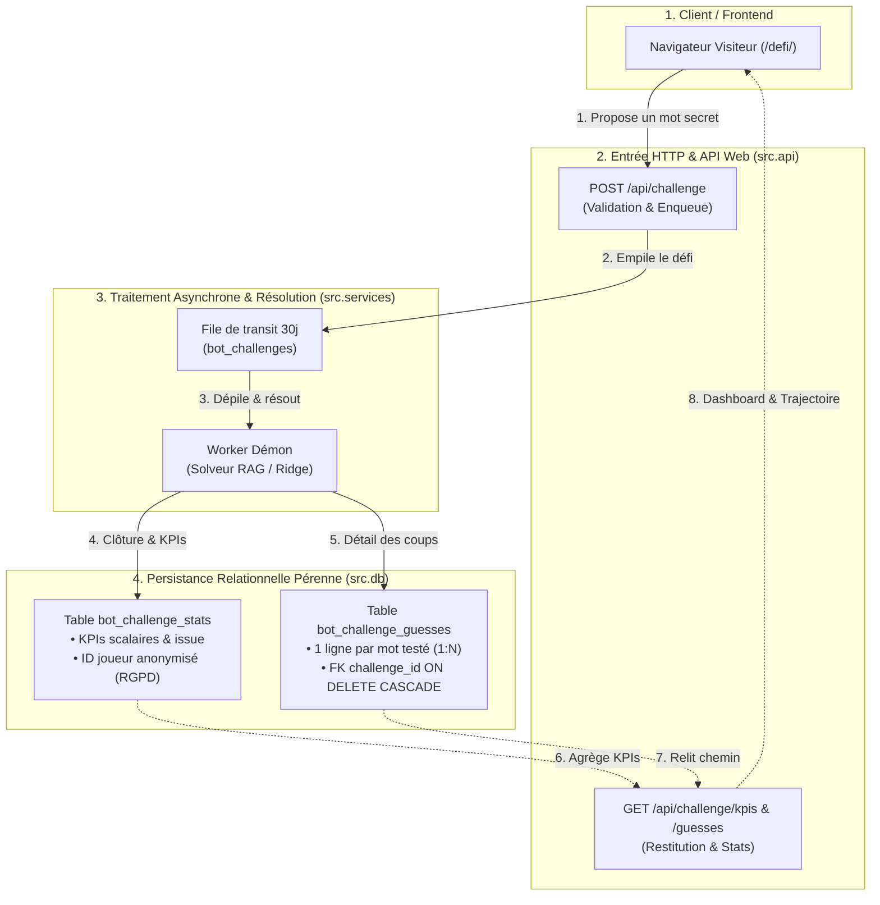

# 📋 Plan d'Implémentation — Traçage en BDD & Métriques KPI des Défis Visiteurs

> **Emplacement :** `docs/PLAN_KPI_DEFIS.md`  
> **Jalon M8 (Socle BDD & Remplissage) :** [`milestones/M8_DEFI_ANALYTICS_KPIS.md`](milestones/M8_DEFI_ANALYTICS_KPIS.md) · [`roadmap/2026-11-01-tracage-kpi-defis/01-plan.md`](roadmap/2026-11-01-tracage-kpi-defis/01-plan.md)  
> **Jalon M9 (Wall of Fame, UI & Replay) :** [`milestones/M9_WALL_OF_FAME_UI.md`](milestones/M9_WALL_OF_FAME_UI.md) · [`roadmap/2026-11-02-wall-of-fame-defis/01-plan.md`](roadmap/2026-11-02-wall-of-fame-defis/01-plan.md)  
> **Date :** Novembre 2026  

---

## 0. Découpage en Deux Jalons Complémentaires

| Jalon | Intitulé & Rôle | Statut & Livrables |
|---|---|---|
| **M8** | **Socle BDD & Remplissage Pérenne (Data Engineering)** | Schémas DDL (`bot_challenge_stats`, `bot_challenge_guesses`), enregistrement atomique, pseudonymisation RGPD, rétro-remplissage 30j. |
| **M9** | **Wall of Fame, Exploitation KPIs & Visualisation (UI / UX)** | Composants `/defi/`, Wall of Fame des mots invaincus, replay interactif du cheminement, bandeau joueur et cache TTL. |

---

## 1. Contexte & Objectifs Métier

Sur la page [`volumes/web/defi/index.html`](../volumes/web/defi/index.html), les visiteurs défient le solveur RAG en imposant un mot secret.  
Actuellement, les défis passent par une table de file d'attente volatile (`bot_challenges`) purgée tous les 30 jours (directive RGPD `SEC-27`). Aucune métrique globale n'est calculée ni affichée pour les utilisateurs.

L'objectif de ce plan est de mettre en place une persistance analytique pérenne, légère et respectueuse de la vie privée pour tracer chaque défi et exposer les KPIs suivants :
1. **Mots joués :** Volume total de défis, historique récent et mots les plus fréquemment proposés.
2. **Performance de l'IA (Taux de victoire / défaite) :**
   - Victoire de l'IA : le bot trouve le mot secret en $\le 100$ coups (`outcome = 'won'`).
   - Victoire du joueur : le bot cale ou atteint 100 coups sans trouver (`outcome = 'lost'`).
   - Pourcentage de réussite du bot vs pourcentage de défis remportés par les visiteurs.
3. **Distribution du nombre de coups :** Moyenne de coups, minimum, maximum et médiane.
4. **Palmarès des mots coriaces :** Mots ayant mis l'IA en échec (mots invaincus).
5. **Scoreboard joueur anonymisé :** Pseudonymisation stricte (`Visiteur #a1b2`) sans jamais stocker ni exposer d'adresse IP brute.

---

## 2. Architecture Technique & Invariants



### Invariants Clés
1. **Idempotence Absolue :** `CREATE TABLE IF NOT EXISTS` et `CREATE INDEX IF NOT EXISTS` dans [`database/init.sql`](../database/init.sql). Insertion idempotente via `ON CONFLICT (challenge_id) DO NOTHING`.
2. **Double Dialecte :** Compatibilité native **PostgreSQL 16** (production) et **SQLite 3** (suite de tests unitaires).
3. **Conformité RGPD :** Dérivation d'un token salé irréversible `joueur_a1b2c3d4` et affichage masqué `Visiteur #a1b2`. Zéro fuite d'adresse IP.
4. **Exécution Docker :** Tous les tests et commandes applicatives s'exécutent exclusivement via Docker.

---

## 3. Spécification DDL (Schémas BDD)

### 3.1 PostgreSQL : `database/init.sql` & `PG_SCHEMA` dans `src/db/connection.py`

```sql
-- 1. Table analytique pérenne des défis visiteurs (Idempotent)
CREATE TABLE IF NOT EXISTS bot_challenge_stats (
    id               SERIAL PRIMARY KEY,
    challenge_id     VARCHAR(32) NOT NULL UNIQUE,
    secret_word      VARCHAR(64) NOT NULL,
    player_anon_id   VARCHAR(32) NOT NULL,
    outcome          VARCHAR(16) NOT NULL, -- 'won', 'lost', 'error'
    tries_count      INT NOT NULL DEFAULT 0,
    duration_seconds NUMERIC(8, 2),
    created_at       TIMESTAMPTZ NOT NULL DEFAULT CURRENT_TIMESTAMP
);
CREATE INDEX IF NOT EXISTS idx_bot_challenge_stats_word ON bot_challenge_stats(secret_word);
CREATE INDEX IF NOT EXISTS idx_bot_challenge_stats_player ON bot_challenge_stats(player_anon_id);
CREATE INDEX IF NOT EXISTS idx_bot_challenge_stats_outcome ON bot_challenge_stats(outcome);
CREATE INDEX IF NOT EXISTS idx_bot_challenge_stats_created ON bot_challenge_stats(created_at);

-- 2. Table relationnelle normalisée des coups / chemin de l'IA (bot_challenge_guesses)
CREATE TABLE IF NOT EXISTS bot_challenge_guesses (
    id           SERIAL PRIMARY KEY,
    challenge_id VARCHAR(32) NOT NULL REFERENCES bot_challenge_stats(challenge_id) ON DELETE CASCADE,
    step_num     INT NOT NULL,
    word         VARCHAR(64) NOT NULL,
    score        NUMERIC(6, 2) NOT NULL,
    permille     INT,
    weather      VARCHAR(8),
    is_record    BOOLEAN DEFAULT FALSE,
    source       VARCHAR(16) DEFAULT 'rag',
    created_at   TIMESTAMPTZ NOT NULL DEFAULT CURRENT_TIMESTAMP,
    UNIQUE(challenge_id, step_num)
);
CREATE INDEX IF NOT EXISTS idx_bcg_challenge ON bot_challenge_guesses(challenge_id);
CREATE INDEX IF NOT EXISTS idx_bcg_word ON bot_challenge_guesses(word);
```

### 3.2 SQLite : `SQLITE_SCHEMA` dans `src/db/connection.py`

```sql
CREATE TABLE IF NOT EXISTS bot_challenge_stats (
    id INTEGER PRIMARY KEY AUTOINCREMENT,
    challenge_id TEXT NOT NULL UNIQUE,
    secret_word TEXT NOT NULL,
    player_anon_id TEXT NOT NULL,
    outcome TEXT NOT NULL,
    tries_count INTEGER NOT NULL DEFAULT 0,
    duration_seconds REAL,
    created_at TEXT NOT NULL DEFAULT CURRENT_TIMESTAMP
);
CREATE INDEX IF NOT EXISTS idx_bot_challenge_stats_word ON bot_challenge_stats(secret_word);
CREATE INDEX IF NOT EXISTS idx_bot_challenge_stats_player ON bot_challenge_stats(player_anon_id);
CREATE INDEX IF NOT EXISTS idx_bot_challenge_stats_outcome ON bot_challenge_stats(outcome);
CREATE INDEX IF NOT EXISTS idx_bot_challenge_stats_created ON bot_challenge_stats(created_at);

CREATE TABLE IF NOT EXISTS bot_challenge_guesses (
    id INTEGER PRIMARY KEY AUTOINCREMENT,
    challenge_id TEXT NOT NULL REFERENCES bot_challenge_stats(challenge_id) ON DELETE CASCADE,
    step_num INTEGER NOT NULL,
    word TEXT NOT NULL,
    score REAL NOT NULL,
    permille INTEGER,
    weather TEXT,
    is_record BOOLEAN DEFAULT 0,
    source TEXT DEFAULT 'rag',
    created_at TEXT NOT NULL DEFAULT CURRENT_TIMESTAMP,
    UNIQUE(challenge_id, step_num)
);
CREATE INDEX IF NOT EXISTS idx_bcg_challenge ON bot_challenge_guesses(challenge_id);
CREATE INDEX IF NOT EXISTS idx_bcg_word ON bot_challenge_guesses(word);
```

---

## 4. Couche Métier & DAO (`src/db/challenges.py`)

- `anonymize_player_token(ip_hash_value: str) -> str` : hachage SHA-256 avec sel applicatif pour produire un token irréversible `joueur_...`.
- `record_challenge_stat(challenge_id, secret_word, ip_hash_value, outcome, tries_count, duration_seconds, created_at)` : insertion idempotente `ON CONFLICT (challenge_id) DO NOTHING`, appelée à la fin de chaque résolution dans `finish_challenge()`.
- `save_challenge_guesses(challenge_id: str, guesses: list[dict]) -> int` : insertion relationnelle par lot des coups du chemin (`step_num`, `word`, `score`, `permille`, `weather`, `is_record`, `source`) avec `ON CONFLICT (challenge_id, step_num) DO NOTHING`.
- `get_challenge_guesses(challenge_id: str) -> list[dict]` : récupération ordonnée des étapes pour la visualisation détaillée d'un défi.
- `get_challenge_kpis(player_ip_hash=None) -> dict` : calcul SQL optimisé des indicateurs globaux (total défis, victoires bot/joueur, pourcentages, moyenne de coups, top mots, mots coriaces) et des scores personnels du visiteur.

---

## 5. API REST HTTP (`src/api/routes/challenge.py`)

- **Route :** `GET /api/challenge/kpis` — statistiques consolidées et bilan joueur.
- **Route :** `GET /api/challenge/<id>/guesses` — restitution du cheminement pas à pas depuis la table relationnelle `bot_challenge_guesses`.
- **Sécurité :** Récupération de l'IP appelante via `extract_client_ip()`, masquage salé et filtrage de ses propres statistiques dans le bloc `player`.
- **Réponse JSON :**
  ```json
  {
    "status": "ok",
    "global": {
      "total_challenges": 142,
      "bot_wins": 118,
      "bot_losses": 24,
      "bot_win_rate_pct": 83.1,
      "player_win_rate_pct": 16.9,
      "avg_tries": 34.2,
      "top_words": [{"word": "pomme", "count": 12}],
      "tough_words": [{"word": "alambic", "tries": 100}],
      "recent_activity": [...]
    },
    "player": {
      "identified": true,
      "display_name": "Visiteur #a1b2",
      "total_played": 3,
      "player_wins": 1,
      "player_losses": 2,
      "player_win_rate_pct": 33.3
    }
  }
  ```

---

## 6. Interface Visiteur (`volumes/web/defi/`)

1. **HTML ([`volumes/web/defi/index.html`](../volumes/web/defi/index.html)) :**
   - 4 cartes métriques en tête de section : Taux de victoire IA (%), Défis totaux, Coups moyens, Mots invaincus.
   - Encadré personnalisé avec le badge visiteur (`Visiteur #a1b2`) et son bilan personnel.
   - Tableau dynamique des derniers défis communautaires avec statut et mot joué.
2. **JavaScript ([`volumes/web/js/defi.js`](../volumes/web/js/defi.js)) :**
   - Fonction `loadChallengeKpis()` exécutée au chargement de la page et rafraîchie à la fin de chaque défi.
   - Échappement HTML strict via `escapeHtml()`.

---

## 7. Plan de Test et Validation Docker

```bash
# 1. Tests unitaires complets (PostgreSQL & SQLite)
docker run --rm -v $(pwd):/app -w /app python:3.12-slim sh -c \
  "pip install --no-cache-dir -r requirements.txt && python -m unittest discover -s tests -v"

# 2. Contrôle de cohérence documentaire (liens, tables, compteurs)
python tools/check_docs.py

# 3. Contrôle du balisage SEO
python tools/check_seo.py

# 4. Contrôle des bundles CSS
python tools/build_css_bundles.py --check
```

