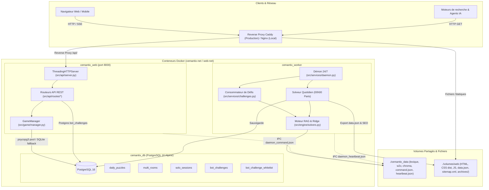

# M0 — Architecture & Maintainability Audit

**Date :** 30 octobre 2026  
**Dépôt :** `Cyrilpop/cemantix-rag-solver`  
**Statut :** Livrable M0 (Audit-First — Aucune modification de code de production)  

---

## 1. Vue d'Ensemble Architecturale

Le projet `cemantix-rag-solver` est un système hybride combinant un solveur sémantique autonome (RAG géométrique sur corpus vectoriel word2vec `frWac` à 500 dimensions et reranking quadratique, assisté optionnellement d'un LLM local compatible OpenAI ChatCompletions) et une plateforme de jeu Web/CLI (Solo, Duel contre l'IA, Multijoueur 1v1 en temps réel/tour-par-tour, Défier le bot, et Dashboard quotidien sans spoiler).

### 1.1 Architecture 3-Tiers Découplée

Le déploiement de production s'articule autour de trois conteneurs orchestrés par `docker-compose.yml` :



### 1.2 Responsabilités des Composants

| Composant | Répertoire / Fichier | Responsabilités Principales | Dépendances Externes |
|---|---|---|---|
| **Point d'Entrée CLI** | `cemantix_rag.py` | Dispatching des commandes CLI (`--daemon`, `--api`, `--play`, `--battle`, `--benchmark`, `--healthcheck`) | argparse, sys, `src` |
| **API Web & HTTP** | `src/api/` | Serveur `ThreadingHTTPServer`, CORS, rate limiting token bucket, routes REST (system, solo, battle, multi, challenge, admin) | `http.server`, `src.game`, `src.db`, `src.services` |
| **Domaine de Jeu** | `src/game/` | Sessions de jeu en mémoire (Solo, Battle vs IA, MultiplayerSession), gestionnaire unifié `GameManager` | `src.engine`, `src.db`, `src.config` |
| **Moteur Algorithmique (RAG)** | `src/engine/` | Régression Ridge multicritère, reranking pondéré par similarité, client Certitudes, VocabStore (lexique + ChromaDB), intégration LLM | `numpy`, `chromadb`, `requests` |
| **CLI & Terminal** | `src/cli/` | Menu interactif ANSI, rendu de plateau, jauges colorées, boucles de tournoi et de benchmark | `src.engine`, `src.config` |
| **Services Applicatifs** | `src/services/` | Démon planificateur 00h00, consommateur asynchrone des défis, génération SEO statique, export `data.json` | `src.db`, `src.engine`, `src.api` |
| **Couche Données (DB)** | `src/db/` | Pool thread-safe de connexions, translation dialecte PostgreSQL ↔ SQLite, persistance multi/solo/daily/défis | `psycopg` (ou fallback `sqlite3`), `src.config` |
| **Frontend Web** | `volumes/web/` | Vanilla JS (ES Modules) & CSS natif. Pages statiques pré-rendues, zéro dépendance NPM au runtime | Caddy / Nginx |

---

## 2. Inventaire Détaillé du Dépôt

### 2.1 Métriques Globales par Langage (Mesurées)

*Mesure reproductible via inspection AST et parcours d'arborescence (excluant `.git/` et `.system_generated/`) :*

| Langage | Fichiers | Lignes (LOC) | Poids (Octets) | Description |
|---|---:|---:|---:|---|
| **Text (Data / Lexique)** | 6 | 46 354 | 476 943 o | Principalement `lexique_fr.txt` (46 219 lignes) |
| **Python** | 63 | 15 064 | 620 185 o | Cœur applicatif, API, CLI, DB, services et tests |
| **CSS** | 16 | 7 677 | 314 470 o | Feuilles sources (`css/*.css`) + bundles compilés (`dist/*.css`) |
| **JavaScript** | 12 | 4 607 | 164 841 o | Modules front ES6 (`app`, `game`, `battle`, `multi`, `defi`, etc.) |
| **Markdown** | 18 | 4 422 | 408 256 o | `README.md`, `CHANGELOG.md`, roadmaps historiques |
| **HTML** | 6 | 2 626 | 301 861 o | 5 pages de jeu + console admin (chargées de CSS critique inline) |
| **Shell** | 8 | 409 | 16 887 o | Scripts de test local et validation |
| **YAML** | 2 | 357 | 13 477 o | `docker-compose.yml`, `.github/workflows/ci.yml` |
| **SQL** | 1 | 77 | 3 263 o | `database/init.sql` (schéma initial Postgres) |
| **TOTAL** | **132** | **81 593** | **2 320 183 o** | *(hors binaires et `.git`)* |

### 2.2 Top 15 des Plus Gros Fichiers du Dépôt

| Fichier | Lignes | Taille | Rôle & Analyse de Responsabilité | Action Recommandée |
|---|---:|---:|---|---|
| `cemantix_data/lexique_fr.txt` | 46 219 | 465 Ko | Dictionnaire des lemmes français filtrés (Lexique 3.83). Fichier de données légitime. | Conserver tel quel. Exclure du contexte agent. |
| `CHANGELOG.md` | 484 | 77 Ko | Historique cumulatif très verbeux (tous les commits/phases détaillés). | Conserver l'historique sans modification. |
| `src/services/seo.py` | 1 692 | 76 Ko | **God Module** : Génère HTML d'archives, index paginé, 2 pages hub, JSON-LD, sitemap XML, manifestes ARD, docs LLM. | À découper en sous-modules dédiés (templates, sitemap, ard). |
| `volumes/web/multi/index.html` | 583 | 72 Ko | HTML multijoueur contenant ~40 Ko de CSS critique minifié inline et JSON-LD. | Extraire les templates et dé-dupliquer les structures communes. |
| `volumes/web/battle/index.html` | 581 | 69 Ko | HTML battle contenant ~38 Ko de CSS critique inline et modales dupliquées. | Idem : gabarit commun. |
| `volumes/web/index.html` | 696 | 68 Ko | Page d'accueil contenant 32 Ko de CSS critique inline et 7 Ko de JSON-LD. | Idem : gabarit commun. |
| `README.md` | 898 | 61 Ko | Manuel utilisateur complet, guide Docker, Caddy, SEO, tableaux ASCII. | Conserver. Référencer via `project-memory.md`. |
| `src/cli/modes.py` | 849 | 39 Ko | Boucles interactives CLI (benchmark, battle, solo, duel). Trop de logique mélangée. | Séparer chaque mode dans son propre module. |
| `volumes/web/js/multi.js` | 1 064 | 37 Ko | Logique frontend multijoueur monolithique (polling, WebSocket simulé, DOM, audio). | Scinder l'état de jeu, le polling réseau et le rendu DOM. |
| `src/engine/solvers.py` | 589 | 26 Ko | Solveur RAG géométrique, Ridge, Rerank, interface LLM, `CemantixSolver`, `RagDuelPlayer`. | Séparer l'algèbre linéaire (Ridge/Rerank) de l'orchestration LLM. |
| `volumes/web/js/battle.js` | 808 | 26 Ko | Logique battle front (tour par tour, IA, affichage des coups, timers). | Mutualiser avec `multi.js` et `game.js`. |
| `volumes/web/js/game.js` | 695 | 26 Ko | Logique solo front. Duplique le rendu des coups déjà présent dans `render.js`. | Adopter `render.js` et éliminer la duplication. |
| `src/game/manager.py` | 554 | 24 Ko | Gestionnaire de sessions multi, solo, battle, pools de difficulté et persistance. | Séparer la gestion de session du cycle de vie des données. |
| `src/db/connection.py` | 608 | 23 Ko | Pool de connexions, gestionnaire de transactions, schémas DDL inline pour PG et SQLite. | Extraire les DDL des constantes Python. |
| `src/cli/menu.py` | 484 | 21 Ko | Menu principal interactif CLI, formulaires de saisie et navigation ANSI. | Maintenir découplé de `modes.py`. |

---

## 3. Analyse de la Complexité & Couplage

### 3.1 Dépendances Circulaires Détectées (Evidence-Based)

L'analyse statique de l'arbre d'importation AST révèle plusieurs cycles masqués par des importations tardives (*in-function deferred imports*) :

1. **Cycle Métier / Données :** `src.db.multi` ↔ `src.game.multi`
   - `src/db/multi.py:163` importe `from ..game.multi import MultiplayerSession` dans une fonction.
   - `src/game/multi.py:127` importe `from ..db.multi import verify_player_key` dans une méthode.
   - *Impact :* Interdépendance directe entre le modèle métier et la couche SQL, empêchant les tests unitaires isolés sans initialisation croisée.

2. **Cycle Services Applicatifs :** `src.services.daemon` ↔ `src.services.seo` ↔ `src.services.web`
   - `src/services/daemon.py:362` importe `from .seo import ensure_seo_published`.
   - `src/services/seo.py:1677` importe `from .daemon import PARIS_TZ, load_history`.
   - `src/services/web.py:22` importe `from .daemon import ...` et à la ligne 195 `from .seo import publish_seo_pages`.
   - *Cause racine :* `PARIS_TZ`, `DAILY_HISTORY_FILE` et `HEARTBEAT_FILE` sont définis dans `src/services/daemon.py` au lieu de `src/config.py`.

3. **Cycle Service / API :** `src.services.daemon` ↔ `src.api.server`
   - `src/api/server.py:432` importe `from ..services.seo import ensure_seo_published`.
   - `src/services/daemon.py:370` importe `from ..api import start_api_thread` et `from ..api.routes.system import invalidate_system_cache`.

4. **Couplage Global par `src/__init__.py` :**
   - `src/__init__.py` pratique un re-export exhaustif : `from .config import *`, `from .db import ...`, `from .engine import ...`, `from .cli import ...`, `from .services import ...`, `from .game import ...`, `from .api import ...`.
   - *Conséquence directe :* N'importe quel `import src` ou sous-import non qualifié charge l'intégralité des dépendances C (`numpy`, `chromadb`, `psycopg`), provoquant des crashs d'importation lors de tests ciblés hors conteneur.

### 3.2 Duplication de Code

1. **Gabarits HTML Frontend :**
   - Le `<header>` (brand bar, sélecteur de thème) de 1 028 caractères est dupliqué à l'identique sur `index.html`, `play/index.html`, `battle/index.html` et `multi/index.html`.
   - Le menu `<nav class="mode-navigation">` est copié-collé sur les 5 pages HTML.
   - Le `<footer>` (liens légaux, version, auteur) est dupliqué 5 fois.
2. **Duplication CSS en 3 Exemplaires :**
   - Les règles CSS existent dans les sources (`volumes/web/css/*.css`).
   - Elles sont concaténées dans `volumes/web/css/dist/*.css` (versionnées sous git).
   - Elles sont inlinées dans `<style id="critical-css">` dans chaque fichier HTML.
   - Une modification nécessite d'éditer la source, de lancer `build_css_bundles.py` pour mettre à jour `dist/` ET de modifier l'HTML.
3. **Rendu des Coups JavaScript :**
   - `volumes/web/js/render.js` a été créé pour mutualiser `buildGuessesListHtml`.
   - Cependant, `volumes/web/js/game.js` (lignes 655 et 680) a réimplémenté son propre rendu de ligne de coup avec les mêmes balises `<div class="guess-row">`, ignorant `render.js`.
4. **Schémas de Base de Données (DDL) :**
   - Le schéma est défini dans `database/init.sql`.
   - Il est réécrit sous forme de chaîne `PG_SCHEMA` dans `src/db/connection.py:59`.
   - Il est réécrit une troisième fois en syntaxe SQLite sous `SQLITE_SCHEMA` dans `src/db/connection.py:125`.

---

## 4. Analyse de Sécurité

### 4.1 Vulnérabilités Identifiées

1. **Usurpation d'Adresse IP via `X-Forwarded-For` (SEC-01) :**
   - *Fichier :* `src/api/server.py:78-83`
   - *Code :*
     ```python
     def _client_ip(self) -> str:
         forwarded = self.headers.get("X-Forwarded-For", "")
         if forwarded:
             return forwarded.split(",")[0].strip()
         return self.client_address[0] if self.client_address else "unknown"
     ```
   - *Faiblesse :* La valeur de l'en-tête `X-Forwarded-For` est acceptée aveuglément sans vérifier si `self.client_address[0]` correspond à un proxy inverse de confiance (ex. `127.0.0.1` ou réseau interne Caddy).
   - *Impact :* Un attaquant peut forger n'importe quel `X-Forwarded-For: 1.2.3.4` pour :
     - Contourner le limiteur de débit global (`_limiter.allow()`).
     - Contourner le limiteur de débit d'authentification sur l'admin (`_login_limiter.allow()`) et brute-forcer `ADMIN_PASSWORD`.
     - Échapper aux quotas journaliers de la file « Défier le bot » (`bot_challenges`).
     - Se faire passer pour une adresse IP figurant sur la `bot_challenge_whitelist`.

2. **Exposition du Socket Unix Docker au Conteneur Web (SEC-02) :**
   - *Fichier :* `docker-compose.yml:129-136`
   - *Configuration :*
     ```yaml
     volumes:
       - /var/run/docker.sock:/var/run/docker.sock:ro
     group_add:
       - "${DOCKER_GID:-120}"
     ```
   - *Faiblesse :* Bien que monté avec l'option `:ro`, le noyau Linux n'applique pas de restrictions en lecture seule sur les sockets de domaine UNIX (`AF_UNIX`). Toute communication HTTP sur le socket permet d'émettre des requêtes POST/DELETE au démon Docker (ex. `/containers/create`).
   - *Usage actuel :* Le conteneur web utilise ce socket uniquement pour relire les logs (`GET /containers/{id}/logs`) dans `src/api/routes/admin.py:166`.
   - *Impact :* En cas de compromission du processus applicatif Python web, l'accès au socket Docker confère un vecteur immédiat d'évasion de conteneur et de prise de contrôle de la machine hôte.

3. **Vulnérabilités Connues non Corrigées dans ChromaDB (SEC-03) :**
   - *Fichier :* `requirements.txt:3` (`chromadb==1.5.9`) et `.github/workflows/ci.yml:87-90`
   - *Vulnérabilités OSV/PyPA :* `PYSEC-2026-311`, `PYSEC-2026-3813`, `PYSEC-2026-3814`, `PYSEC-2026-3815`.
   - *Analyse :* La CI ignore ces alertes via `--ignore-vuln` car aucun correctif officiel n'est publié pour la branche compatible Python 3.12. Cependant, `continue-on-error: true` sur le job d'audit masque toute nouvelle vulnérabilité introduite.

4. **Portes d'Administration par Obscurité (SEC-04) :**
   - *Fichier :* `src/api/routes/admin.py:40`
   - *Code :* `ADMIN_BASE_PATH = os.getenv("ADMIN_API_PATH", "/api/snap-9x")`
   - *Faiblesse :* Le chemin d'API est supposé "non devinable", mais le répertoire statique `volumes/web/panier-9x/` le rend trivialement découvrable.
   - *Garde-fou existant :* Si `ADMIN_PASSWORD` est vide, les routes répondent 403. La dérivation du jeton par HMAC SHA-256 (`_token_secret()`) est robuste, mais la protection brute-force est affaiblie par SEC-01.

---

## 5. Couverture de Tests & Assurance Qualité

### 5.1 Bilan d'Exécution des Tests Unitaires

*Exécution dans l'environnement cible `python:3.12-slim` (standard CI) :*
- **163 tests exécutés en 3.415 secondes.**
- **Résultat :** `OK` (0 échec, 0 erreur).
- *Observation :* Le `README.md` mentionne « 81 tests unitaires » : la documentation est désynchronisée de la réalité de la suite de tests.

### 5.2 Couverture par Composant (Coverage 7.17.0)

| Module / Sous-Système | Déclarations | Manquées | Couverture (%) | Évaluation du Risque de Régression |
|---|---:|---:|---:|---|
| `src/services/seo.py` | 430 | 44 | **90%** | Faible (très bien couvert par 4 suites de tests) |
| `src/db/challenges.py` | 96 | 6 | **94%** | Faible |
| `src/api/routes/challenge.py` | 163 | 26 | **84%** | Faible |
| `src/config.py` | 130 | 17 | **87%** | Faible |
| `src/db/connection.py` | 307 | 64 | **79%** | Modéré (pool et transactions testés, SQLite testé) |
| `src/api/routes/admin.py` | 334 | 144 | **57%** | Modéré |
| `src/services/daemon.py` | 299 | 237 | **21%** | **Élevé** (boucle du démon et IPC non testés) |
| `src/api/server.py` | 262 | 201 | **23%** | **Élevé** (dispatching HTTP peu couvert) |
| `src/engine/vocab.py` | 249 | 187 | **25%** | **Élevé** (chargement w2v mocké mais non exécuté) |
| `src/db/daily.py` | 59 | 34 | **42%** | Modéré |
| `src/db/multi.py` | 76 | 60 | **21%** | **Élevé** |
| `src/db/solo.py` | 62 | 52 | **16%** | **Élevé** |
| `src/api/routes/solo.py` | 57 | 51 | **11%** | **Critique** |
| `src/api/routes/battle.py` | 51 | 46 | **10%** | **Critique** |
| `src/game/manager.py` | 342 | 307 | **10%** | **Critique** (cœur de session quasiment sans test) |
| `src/game/multi.py` | 259 | 236 | **9%** | **Critique** |
| `src/game/battle.py` | 152 | 140 | **8%** | **Critique** |
| `src/engine/solvers.py` | 405 | 379 | **6%** | **Critique** (le solveur RAG mathématique est non couvert) |
| `src/api/routes/multi.py` | 117 | 111 | **5%** | **Critique** |
| `src/cli/menu.py` | 366 | 353 | **4%** | Élevé |
| `src/cli/modes.py` | 627 | 616 | **2%** | **Critique** |
| `src/cli/ui.py` | 261 | 246 | **6%** | Modéré |
| **TOTAL GLOBAL** | **5 722** | **3 898** | **32%** | **Dette de test critique sur le domaine de jeu et le solveur** |

---

## 6. Forces Architecturales à Préserver

Toute évolution ou refactorisation ultérieure devra impérativement préserver ces points forts :

1. **Architecture Découplée sans Framework Lourd :**
   - Utilisation judicieuse de la bibliothèque standard Python (`ThreadingHTTPServer`, `sqlite3`, `hashlib`, `hmac`, `urllib`).
   - Aucune dépendance inutile (pas de Django, FastAPI, Celery, Redis). L'empreinte mémoire et la vitesse de démarrage sont exemplaires.
2. **Repli Gracieux Automatique (Graceful Fallback) :**
   - Détection transparente de PostgreSQL avec repli immédiat sur SQLite local (`src/db/connection.py`). Les tests tournent sans conteneur.
   - Mode 100% RAG mathématique (`--rag-only`) permettant de fonctionner en autarcie complète sans LLM ni connexion réseau sortante.
   - Simulation locale déterministe avec `MockClient`.
3. **Durcissement des Conteneurs Docker :**
   - Utilisateur non-root dédié `cemantix` (UID/GID 1000).
   - Système de fichiers racine en lecture seule (`read_only: true`), `cap_drop: [ALL]`, `no-new-privileges: true`, `tmpfs` isolés.
4. **Excellence SEO & Rendu Statique :**
   - Rendu HTML statique pré-généré pour tous les moteurs de recherche et agents sans JavaScript.
   - Balisage schema.org JSON-LD très riche (FAQPage, HowTo, BreadcrumbList).
   - Manifestes ARD et documentation standardisée pour agents IA (`llms.txt`, `openapi.json`).
5. **Validation stricte au démarrage :**
   - `enforce_runtime_config()` empêche le démarrage si un mot de passe par défaut de `.env.example` est détecté en production.

---

## 7. Registre Classifié des Découvertes

| ID | Domaine | Gravité | Confiance | Impact | Effort | Risque Régression | Localisation | Description Sommaire |
|---|---|---|---|---|---|---|---|---|
| **ARC-01** | Sécurité | **Haute** | Certaine | Contournement Rate-Limit / Quotas / Auth | Faible | Très faible | `src/api/server.py:78-83` | `X-Forwarded-For` accepté aveuglément sans validation du proxy de confiance. |
| **ARC-02** | Sécurité | **Haute** | Certaine | Évasion potentielle du conteneur | Moyen | Faible | `docker-compose.yml:129` | Montage du socket Unix Docker dans le conteneur web exposé sur internet. |
| **ARC-03** | Tests | **Haute** | Certaine | Régression silencieuse lors de refactorings | Moyen | Très faible | `src/engine/solvers.py`, `src/game/` | Couverture globale de 32% ; le cœur de jeu et le solveur ont <10% de couverture. |
| **ARC-04** | Architecture | **Moyenne** | Certaine | Maintenance pénible, risque d'erreur | Moyen | Moyen | `src/services/seo.py:1-1692` | God module SEO de 1 692 lignes regroupant HTML, sitemap, ARD et JSON-LD. |
| **ARC-05** | Architecture | **Moyenne** | Certaine | Imports différés fragiles, couplage fort | Faible | Faible | `src/db/multi.py`, `src/game/multi.py` | Cycles d'importation masqués par des imports internes aux fonctions. |
| **ARC-06** | Architecture | **Moyenne** | Certaine | Crash d'importation hors conteneur | Faible | Faible | `src/__init__.py:1-100` | Re-export global créant un couplage fort entre tous les sous-packages. |
| **ARC-07** | Sécurité / CI| **Moyenne** | Certaine | Vulnérabilités ignorées, pipeline permissif | Faible | Très faible | `.github/workflows/ci.yml:41,72` | `continue-on-error: true` sur lint et audit ; 5 CVEs ChromaDB ignorées. |
| **ARC-08** | Performance | **Moyenne** | Haute | Risque de saturation sous trafic concurrent | Moyen | Modéré | `src/api/server.py:65`, `src/db/connection.py:45` | `ThreadingHTTPServer` (1 thread/connexion) combiné à un pool DB plafonné à 8. |
| **ARC-09** | Duplication | **Basse** | Certaine | Maintenance 3x plus lourde, risque de drift | Moyen | Faible | `volumes/web/**/*.html`, `tools/build_css_bundles.py` | Triple duplication du CSS (sources, dist, inline) et gabarits HTML dupliqués. |
| **ARC-10** | Documentation| **Basse** | Certaine | Désinformation des agents et développeurs | Faible | Nul | `cemantix_rag.py:15-24`, `README.md:175` | Docstrings et compteurs de tests désynchronisés de l'arborescence réelle. |
