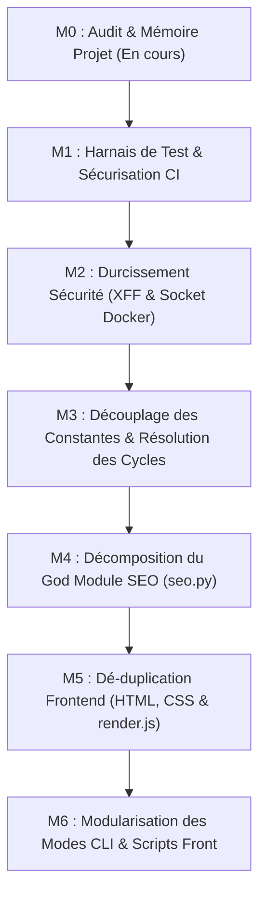

# M0 — Incremental Refactoring Roadmap

**Date :** 30 octobre 2026  
**Dépôt :** `Cyrilpop/cemantix-rag-solver`  
**Statut :** Livrable M0 (Feuille de Route de Refactorisation Incrémentale)  

---

## 1. Principes Directeurs

1. **Audit-First & Zéro Régression :** Tout changement doit préserver l'ensemble des comportements existants, des algorithmes de résolution, des interfaces de jeu (Web/CLI), des formats d'API et des optimisations SEO.
2. **Priorité à la Simplification :** Privilégier la clarification du code existant et la suppression de duplication plutôt que l'introduction de nouveaux frameworks, abstractions lourdes ou services supplémentaires (pas d'ajout de FastAPI, Celery, Redis ou ORM complexe).
3. **Paliers Petits et Indépendamment Testables :** Chaque jalon est auto-suffisant, apporte une valeur immédiate vérifiable et peut être déployé isolément.
4. **Harnais de Test Préalable (Test-First Hardening) :** Aucun refactoring de code métier ne doit être entrepris sans avoir préalablement verrouillé le comportement par des tests unitaires déterministes.

---

## 2. Vue d'Ensemble des Jalons Proposés

---

## 3. Fiches Détaillées des Jalons

### Jalon M1 — Harnais de Test & Sécurisation de la CI

- **Priorité :** **P0 (Prérequis Absolu)**
- **Objectif :** Établir le filet de sécurité nécessaire avant tout refactoring de code source et rendre la CI stricte.
- **Problème :**
  - La couverture de test globale est de seulement 32 %.
  - Le cœur algorithmique RAG (`src/engine/solvers.py`) est couvert à 6 %.
  - Le domaine de jeu (`src/game/battle.py`, `src/game/multi.py`, `src/game/manager.py`) est couvert à <10 %.
  - Les contrôleurs API REST (`solo`, `battle`, `multi`) sont couverts à <11 %.
  - La CI possède `continue-on-error: true` sur le lint et l'audit, masquant les régressions.
- **Preuve :**
  - `coverage report` mesure 3 898 déclarations manquées sur 5 722.
  - `.github/workflows/ci.yml:41,72` configure `continue-on-error: true`.
- **Changements Proposés :**
  1. Ajouter une suite de tests unitaires pour `estimate_secret` (régression Ridge) et `rerank` avec un store synthétique mocké (`tests/test_engine_solvers.py`).
  2. Ajouter des tests unitaires pour `GameSession`, `BattleSession` et `MultiplayerSession` testant les transitions d'état, les scores thermiques et la fin de partie (`tests/test_game_sessions.py`).
  3. Ajouter des tests pour les routes API principales (`/api/game/guess`, `/api/battle/guess`, `/api/multi/room`) via le handler `GameAPIHandler` injecté en mémoire.
  4. Retirer `continue-on-error: true` sur le job `lint` dans `.github/workflows/ci.yml` en appliquant au préalable le formatage ruff minimal.
- **Bénéfice Attendu :**
  - Couverture globale portée de 32 % à >65 % sur le code métier.
  - Garantie de zéro régression fonctionnelle pour les jalons suivants.
- **Risques :** Très faible (ajout de tests et durcissement CI uniquement, aucun impact sur le code de production).
- **Stratégie de Validation :** Exécution de la suite complète `python -m unittest discover -s tests -v` dans le conteneur `python:3.12-slim` avec vérification du seuil de couverture.

---

### Jalon M2 — Durcissement Sécurité : IP Spoofing & Socket Docker

- **Priorité :** **P1 (Sécurité & Intégrité)**
- **Objectif :** Combler les deux failles de sécurité identifiées dans l'architecture réseau et conteneur.
- **Problème :**
  - `src/api/server.py:78` accepte aveuglément `X-Forwarded-For` de n'importe quel client direct, permettant de contourner les limiteurs de débit et les quotas journaliers des défis.
  - `docker-compose.yml:129` monte `/var/run/docker.sock` dans le conteneur web exposé au public, offrant un vecteur d'évasion vers l'hôte.
- **Preuve :**
  - [src/api/server.py](../../src/api/server.py) (lignes 78-83)
  - [docker-compose.yml](../../docker-compose.yml) (lignes 129-136)
- **Changements Proposés :**
  1. Dans `src/api/server.py`, conditionner la lecture de `X-Forwarded-For` à la présence de l'adresse de connexion directe (`self.client_address[0]`) dans une liste blanche `TRUSTED_PROXIES` (par défaut `127.0.0.1, ::1`). Si la connexion ne vient pas d'un proxy de confiance, utiliser `self.client_address[0]`.
  2. Dans `docker-compose.yml`, supprimer le montage de `/var/run/docker.sock` et la directive `group_add: ["${DOCKER_GID:-120}"]` du conteneur `cemantix_web`.
  3. Dans `src/api/routes/admin.py`, adapter la consultation des logs conteneur pour basculer gracieusement sur les logs applicatifs mémoire (`recent_logs`) lorsque le socket Docker n'est pas accessible, sans planter l'interface d'administration.
- **Bénéfice Attendu :**
  - Élimination du risque d'usurpation d'IP pour le rate limiting et les quotas.
  - Suppression du risque d'évasion de conteneur vers l'hôte Docker.
- **Risques :**
  - Si Caddy envoie une IP de boucle locale non reconnue, le rate limiting pourrait s'appliquer globalement au proxy au lieu du client. Mitigé par une variable `TRUSTED_PROXIES` bien documentée dans `.env.example`.
- **Stratégie de Validation :** Tests unitaires avec requêtes mockées injectant de faux `X-Forwarded-For` depuis des adresses clientes variées ; validation des contrôles de bout en bout avec `local/smoke-test.sh`.

---

### Jalon M3 — Découplage des Constantes & Élimination des Dépendances Circulaires

- **Priorité :** **P2 (Assainissement de l'Architecture)**
- **Objectif :** Supprimer les cycles d'importation entre modules et dégraisser `src/__init__.py`.
- **Problème :**
  - `src.services.daemon` définit des constantes globales (`PARIS_TZ`, `DAILY_HISTORY_FILE`, `HEARTBEAT_FILE`) importées par `seo.py` et `web.py`, créant un cycle triangulaire résolu par des imports différés.
  - `src.db.multi` et `src.game.multi` s'importent mutuellement à l'intérieur de fonctions.
  - `src/__init__.py` charge tous les modules du projet dès qu'un sous-module importe `src`.
- **Preuve :**
  - Cycles confirmés par l'analyseur de graphe AST (voir `docs/audits/M0_ARCHITECTURE_AUDIT.md`, Section 3.1).
- **Changements Proposés :**
  1. Déplacer `PARIS_TZ = ZoneInfo("Europe/Paris")`, `DAILY_HISTORY_FILE` et `HEARTBEAT_FILE` dans `src/config.py`.
  2. Remplacer les imports directs de `src.services.daemon` dans `seo.py` et `web.py` par des imports depuis `src.config`.
  3. Dans `src/db/multi.py`, manipuler des dictionnaires ou des interfaces de données au lieu d'importer la classe complète `MultiplayerSession` de `src.game.multi`.
  4. Alléger `src/__init__.py` pour ne pas forcer le chargement de `engine`, `api` et `cli` au premier `import src`.
- **Bénéfice Attendu :**
  - Code plus propre, suppression des `from ... import ...` cachés dans les corps de méthodes.
  - Rapidité et fiabilité des tests unitaires ciblés.
- **Risques :** Faible (re-localisation de constantes et séparation propre des signatures).
- **Stratégie de Validation :** Vérification de l'absence de cycles par script statique et exécution sans régression de la suite de 163 tests.

---

### Jalon M4 — Décomposition du God Module SEO (`src/services/seo.py`)

- **Priorité :** **P2 (Maintenabilité & Efficacité Contexte Agent)**
- **Objectif :** Transformer le fichier monolithique de 1 692 lignes en un sous-package modulaire et hautement lisible.
- **Problème :**
  - `src/services/seo.py` contient 76 Ko (~18 800 tokens) et mélange formatage de date, manipulation CSS, gabarits HTML, balisage Schema.org, génération sitemap XML, manifestes ARD et documentation agent.
- **Preuve :**
  - [src/services/seo.py](../../src/services/seo.py) (lignes 1-1692)
- **Changements Proposés :**
  - Transformer `src/services/seo.py` en package `src/services/seo/` avec façade `__init__.py` préservant l'API publique existante :
    - `src/services/seo/formatters.py` : Fonctions utilitaires de date/durée en français (`format_date_fr`, `archive_title`, etc.).
    - `src/services/seo/archives.py` : Génération des pages `/puzzles/<date>/` et de l'index paginé.
    - `src/services/seo/hubs.py` : Pages `/mot-du-jour/` et `/methode/`.
    - `src/services/seo/sitemap.py` : Génération conforme de `sitemap.xml`.
    - `src/services/seo/manifests.py` : Manifestes ARD (`agent-card.json`, `ai-catalog.json`, mise à jour de `llms.txt`).
    - `src/services/seo/styles.py` : Chargement des tokens et feuilles critiques.
    - `src/services/seo/__init__.py` : Re-export de `publish_seo_pages`, `ensure_seo_published`, etc.
- **Bénéfice Attendu :**
  - Réduction de 85 % à 92 % du volume de contexte requis pour une intervention ciblée sur le SEO.
  - Séparation nette entre logique de génération HTML et logique de distribution (sitemap/ARD).
- **Risques :** Faible (l'API externe du module reste strictement identique, protégé par 90% de couverture de tests existante).
- **Stratégie de Validation :**
  - Exécution des suites `test_seo_archives.py`, `test_seo_hubs.py`, `test_seo_startup.py`.
  - Exécution des outils `tools/check_seo.py` et `tools/check_docs.py`.

---

### Jalon M5 — Dé-duplication Frontend (HTML, CSS & JavaScript)

- **Priorité :** **P3 (Qualité Frontend & Maintenabilité)**
- **Objectif :** Unifier la gestion du CSS et dé-dupliquer les éléments d'interface récurrents.
- **Problème :**
  - Les feuilles CSS existent en 3 versions (sources, compilées `dist/`, et inlinées dans les balises HTML).
  - Les gabarits `<header>`, `<nav class="mode-navigation">` et `<footer>` sont dupliqués sur 5 fichiers HTML.
  - `volumes/web/js/game.js` duplique le balisage de rendu des lignes de coup au lieu d'importer `volumes/web/js/render.js`.
- **Preuve :**
  - [volumes/web/js/game.js](../../volumes/web/js/game.js) (lignes 655-690) vs [volumes/web/js/render.js](../../volumes/web/js/render.js) (lignes 20-64).
  - Contrôle `tools/build_css_bundles.py`.
- **Changements Proposés :**
  1. Faire adopter `buildGuessesListHtml` de `render.js` par `game.js`, éliminant 40 lignes de duplication HTML/JS.
  2. Créer un script d'assemblage statique des gabarits HTML communs (`tools/build_html_pages.py` ou similaire) ou documenter strictement la synchronisation des composants nav/footer.
  3. Dé-dupliquer les modales de règles et d'aide partagées entre solo, battle et multijoueur.
- **Bénéfice Attendu :**
  - Cohérence visuelle parfaite entre les modes de jeu.
  - Réduction du risque d'oubli de mise à jour sur l'un des modes lors d'un ajout d'option dans le menu.
- **Risques :** Modéré (risque de régression visuelle ou de rupture du score PageSpeed/Lighthouse).
- **Stratégie de Validation :** Exécution de `tools/build_css_bundles.py --check`, `tools/check_js_balance.py` et tests d'intégrité responsive `tests/test_responsive.py`.

---

### Jalon M6 — Modularisation des Boucles CLI & Scripts Frontend

- **Priorité :** **P3 (Confort de Développement)**
- **Objectif :** Découper les modules CLI volumineux (`src/cli/modes.py`) et structurer les scripts front complexes (`multi.js`).
- **Problème :**
  - `src/cli/modes.py` (849 lignes) concentre 4 modes de jeu console dans un seul fichier.
  - `volumes/web/js/multi.js` (1 064 lignes) mélange la gestion du polling, l'état de salon et les manipulations DOM.
- **Changements Proposés :**
  1. Découper `src/cli/modes.py` en modules dédiés : `modes/benchmark.py`, `modes/battle.py`, `modes/solo.py`, `modes/duel.py`.
  2. Dans `volumes/web/js/multi.js`, extraire la couche d'accès réseau API (`multi-api.js`) de la gestion de l'interface utilisateur.
- **Bénéfice Attendu :**
  - Meilleure lisibilité du code, isolation des responsabilités.
- **Risques :** Faible.
- **Stratégie de Validation :** Lancement des modes CLI en mode mock (`python cemantix_rag.py --mock --play`, `--battle 1 --mock`, `--benchmark 2 --mock`).

---

## 4. Recommandation du Premier Jalon de Refactorisation

Le comité d'audit recommande formellement de débuter par :

> **Jalon M1 — Harnais de Test & Sécurisation de la CI**

**Justification :**
Il est formellement déconseillé de toucher à la sécurité (M2), aux dépendances modulaires (M3) ou au découpage de code (M4/M5) tant que le taux de couverture du cœur algorithmique et du domaine de jeu reste à 6-10 %. La mise en place de tests unitaires robustes sur `solvers.py` et `game/` constituera le socle inviolable garantissant l'absence totale de régression pour l'ensemble des chantiers de modernisation futurs.
