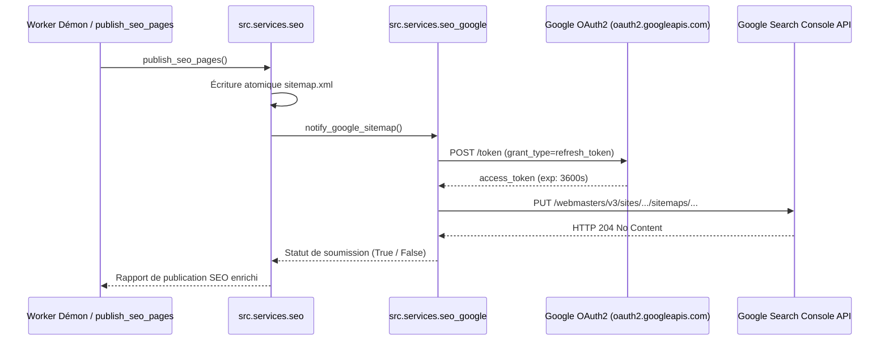

# Jalon M10 — Soumission Automatique du Sitemap à Google Search Console

**Dépôt :** `Cyrilpop/cemantix-rag-solver`  
**Branche visée :** `feature/m10-google-search-console-sitemap` (base `origin/main`)  
**Statut :** Spécification technique & contrat d'implémentation SEO / API Google  
**Périmètre exclusif :** `src/services/seo_google.py`, `src/services/seo.py`, CLI `cemantix_rag.py`, suite de tests `tests/test_seo_google.py`, et documentation associée (`docs/roadmap/`, `README.md`, `CHANGELOG.md`).  
**Suite de validation requise :** Tests unitaires sous Docker Python 3.12 (`docker compose`), `tools/check_docs.py`, `tools/check_seo.py`, `tools/build_css_bundles.py --check`.

---

## 1. Objectifs Métier et Contexte SEO

Le solveur Cémantix publie quotidiennement de nouvelles pages d'archives (`/puzzles/AAAA-MM-JJ/`), met à jour la page hub `/mot-du-jour/` et réécrit son fichier `volumes/web/sitemap.xml`.

Afin d'accélérer l'indexation de ces nouveaux contenus par le moteur de recherche Google sans attendre un passage aléatoire du robot d'exploration :
1. **Soumission programmatique immédiate :** L'API officielle Google Search Console v1 (`webmasters.sitemaps.submit`) doit être notifiée à chaque actualisation du sitemap.
2. **Autonomie et durabilité (Headless) :** Après une autorisation initiale unique fournissant un jeton de rafraîchissement (`GOOGLE_REFRESH_TOKEN`), le démon de minuit et le conteneur worker s'exécutent de façon 100 % autonome sans intervention humaine.
3. **Résilience et non-bloquance :** Si l'API Google est temporairement indisponible, si le quota est dépassé ou si les identifiants sont absents, le processus de publication SEO et le démon 24h/24 continuent normalement avec un avertissement explicite dans les logs.

---

## 2. Spécification Technique & Flux OAuth 2.0 / Search Console

### 2.1 Variables d'Environnement Supportées (`.env`)

Le module lit en priorité `os.environ` et analyse gracieusement `.env` à la racine si nécessaire :
- `GOOGLE_CLIENT_ID` : Identifiant client OAuth 2.0 Google.
- `GOOGLE_CLIENT_SECRET` : Clé secrète client Google (avec repli sur `GOOCLE_CLIEBNT_SECRET` pour tolérer la faute de frappe initiale).
- `GOOGLE_REFRESH_TOKEN` : Jeton de rafraîchissement longue durée pour renouveler les jetons d'accès.
- `GOOGLE_TOKEN_URI` : URL du endpoint de token (`https://oauth2.googleapis.com/token` par défaut).
- `GOOGLE_AUTH_URI` : URL d'autorisation interactive (`https://accounts.google.com/o/oauth2/auth` par défaut).
- `GOOGLE_REDIRECT_URIS` : URI de redirection enregistrée dans la console Google Cloud.

### 2.2 Endpoints et Contrat d'Échange

1. **Génération d'URL d'autorisation (Une seule fois à l'initialisation) :**
   - Portée (*scope*) : `https://www.googleapis.com/auth/webmasters`
   - Paramètres : `access_type=offline`, `prompt=consent`, `response_type=code`.
2. **Échange code d'autorisation → `refresh_token` :**
   - Requête `POST https://oauth2.googleapis.com/token`
   - Corps : `grant_type=authorization_code`, `code=...`, `client_id=...`, `client_secret=...`, `redirect_uri=...`.
3. **Obtention du jeton d'accès (`access_token`) :**
   - Requête `POST https://oauth2.googleapis.com/token`
   - Corps : `grant_type=refresh_token`, `refresh_token=...`, `client_id=...`, `client_secret=...`.
4. **Soumission du sitemap à Google Search Console :**
   - Requête `PUT https://www.googleapis.com/webmasters/v3/sites/{siteUrl}/sitemaps/{feedpath}`
   - En-tête : `Authorization: Bearer <access_token>`
   - `{siteUrl}` : `https://cemantix.cyril-randon.fr/` (URL-encodée).
   - `{feedpath}` : `https://cemantix.cyril-randon.fr/sitemap.xml` (URL-encodée).
   - Réponse attendue : HTTP `204 No Content` ou `200 OK`.

---

## 3. Plan d'Architecture & Modules

### 3.1 Nouveaux Composants et Modélisation
- `src/services/seo_google.py` :
  - `get_google_credentials()` : Extraction des credentials avec validation et fallback de casse/typo.
  - `generate_auth_url()` : Fournit le lien d'autorisation à l'administrateur.
  - `exchange_code_for_tokens(code)` : Échange le code temporaire contre le `refresh_token`.
  - `get_access_token(credentials)` : Rafraîchit et met en cache mémoire le token d'accès.
  - `submit_sitemap_to_google(site_url, sitemap_url)` : Exécute le `PUT` HTTP avec gestion d'erreurs robuste.
- Branchement dans [`src/services/seo.py`](../../src/services/seo.py) :
  - Appel automatique à la fin de `publish_seo_pages()`.
  - Clé `"google_sitemap_submitted"` incluse dans le dictionnaire de retour.
- Option CLI dans [`cemantix_rag.py`](../../cemantix_rag.py) :
  - Flag `--submit-sitemap` : Force la soumission manuelle immédiate.
  - Flag `--google-auth` : Assistant d'appairage initial affichant l'URL et permettant de valider le code d'autorisation.
