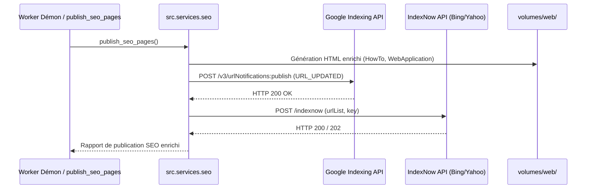

# Jalon M11 — Indexation Instantanée (Google Indexing API, IndexNow) & Balisages Schema.org Avancés

**Dépôt :** `Cyrilpop/cemantix-rag-solver`  
**Branche visée :** `feature/m11-instant-indexing-rich-snippets` (base `origin/main`)  
**Statut :** ✅ Implémenté et validé sous Docker (7 tests unitaires dédiés, suite globale 386 tests verte)  
**Périmètre exclusif :** `src/services/seo_google.py`, `src/services/seo_indexnow.py`, `src/services/seo_templates.py`, `src/services/seo_hubs.py`, `src/services/seo.py`, CLI `cemantix_rag.py`, suite de tests `tests/test_instant_indexing.py`, et documentation associée (`docs/roadmap/`, `README.md`, `CHANGELOG.md`).  
**Suite de validation requise :** Tests unitaires sous Docker Python 3.12 (`docker compose`), `tools/check_docs.py`, `tools/check_seo.py`, `tools/build_css_bundles.py --check`.

---

## 1. Objectifs Métier et Accélération de l'Indexation

Le Jalon M10 a automatisé la soumission de `sitemap.xml` auprès de Google Search Console.  
Le présent **Jalon M11** déploie la couche supérieure d'indexation instantanée (*push crawl*) et d'enrichissement des résultats Google (Rich Snippets) :

1. **Google Indexing API (Signal Push Immédiat) :**  
   Notification en temps réel via l'API Google Indexing (`urlNotifications:publish`) pour inciter Googlebot à visiter et indexer la nouvelle archive `/puzzles/AAAA-MM-JJ/`, le hub `/mot-du-jour/` et l'accueil `/` dès la fin de la résolution quotidienne de minuit.
2. **Protocole IndexNow (Bing & Yahoo) :**  
   Notification instantanée des moteurs alternatifs (Bing, Yahoo, DuckDuckGo) via le protocole ouvert IndexNow avec clé d'API vérifiée automatiquement.
3. **Données Structurées Schema.org Avancées (SERP Étoilée & Dépliables) :**  
   - Intégration du schéma `HowTo` sur la page `/methode/` pour faire apparaître les étapes méthodologiques dans les encadrés dépliables Google.
   - Intégration du schéma `WebApplication` sur l'accueil `/` et la vue `/play/` pour catégoriser le site comme jeu sémantique gratuit.
4. **Résilience et Zéro Blocage :**  
   Toutes les notifications d'indexation s'exécutent de façon non bloquante avec repli silencieux en cas d'indisponibilité réseau.
5. **Protection de Quota et Évitement des Doublons (Flag en Base) :**  
   Google Indexing API imposant un quota journalier (200 notifications/jour), l'ajout d'une colonne `google_indexed_at` dans la table relationnelle `daily_puzzles` permet de mémoriser l'horodatage d'indexation réussie. Si le puzzle du jour est déjà indexé, les déclenchements ultérieurs (redémarrages de conteneurs, régénérations de pages) sautent l'appel réseau pour préserver le quota, sauf si l'option `--force` est explicitement requise.

---

## 2. Spécification Technique des Flux



### 2.1 Google Indexing API (`src/services/seo_google.py`)
- Endpoint : `POST https://indexing.googleapis.com/v3/urlNotifications:publish`
- Authentification : Portée OAuth 2.0 `https://www.googleapis.com/auth/indexing`
- Payload :
  ```json
  {
    "url": "https://cemantix.cyril-randon.fr/puzzles/AAAA-MM-JJ/",
    "type": "URL_UPDATED"
  }
  ```

### 2.2 Protocole IndexNow (`src/services/seo_indexnow.py`)
- Endpoint : `POST https://api.indexnow.org/indexnow`
- Clé d'API : Variable `INDEXNOW_KEY` dans `.env` (ou génération persistante dans `volumes/web/<key>.txt`).
- Payload :
  ```json
  {
    "host": "cemantix.cyril-randon.fr",
    "key": "...",
    "keyLocation": "https://cemantix.cyril-randon.fr/<key>.txt",
    "urlList": [
      "https://cemantix.cyril-randon.fr/",
      "https://cemantix.cyril-randon.fr/mot-du-jour/",
      "https://cemantix.cyril-randon.fr/puzzles/AAAA-MM-JJ/"
    ]
  }
  ```

### 2.3 Schémas Schema.org JSON-LD
- **`HowTo` sur `/methode/`** : 4 étapes concrètes (Amorçage, Thermomètre, Synonymes, Résolution).
- **`WebApplication` sur `/` et `/play/`** : métadonnées applicatives (`applicationCategory: GameApplication`, `operatingSystem: All`, `offers: Free`).
