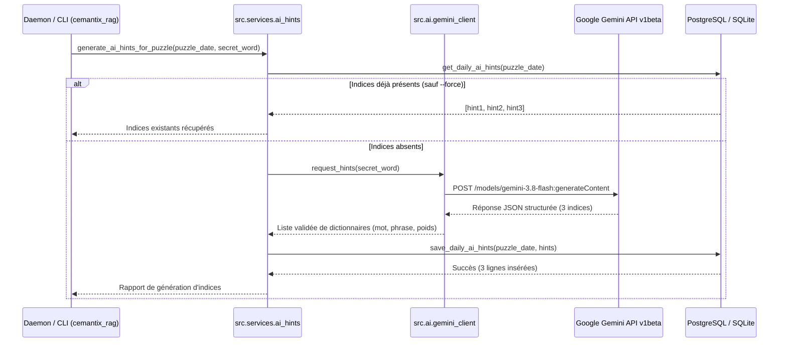

# Jalon M12 — Génération & Persistance d'Indices IA par Google Gemini

**Dépôt :** `Cyrilpop/cemantix-rag-solver`  
**Branche visée :** `feature/m12-gemini-ai-hints` (base `origin/main`)  
**Statut :** ✅ Validé  
**Périmètre exclusif :** `database/init.sql`, `src/db/connection.py`, `src/db/daily.py`, `src/db/__init__.py`, nouveau module `src/ai/` (`__init__.py`, `gemini_client.py`, `model_selector.py`, `prompts.py`), `src/services/ai_hints.py`, `src/services/daemon.py`, CLI `cemantix_rag.py`, suite de tests `tests/test_ai_hints.py`, et documentation associée (`docs/roadmap/`, `README.md`, `CHANGELOG.md`).  
**Périmètre exclu pour ce jalon :** Pas de modification des interfaces web frontend (`volumes/web/**`).  
**Suite de validation requise :** Tests unitaires sous Docker Python 3.12 (`docker compose` ou conteneur `python:3.12-slim`), `tools/check_docs.py`, `tools/check_seo.py`, `tools/build_css_bundles.py --check`.  
**Règle d'or environnement :** L'intégralité du projet s'exécute sous Docker. Aucune commande Python, pip ou test ne doit être exécutée directement sur la machine hôte.

---

## 1. Objectifs Métier et Valeur Ajoutée IA

Les indices actuels du projet reposent sur le vocabulaire vectoriel RAG par paliers de score sémantique (`daily_puzzle_hints`, Jalon M6).  
Le présent **Jalon M12** introduit la génération d'indices sémantiques et contextuels propulsés par l'IA générative Google Gemini (`GEMINI_API_KEY`) :

1. **Trois Niveaux d'Indices Gradués (Pondération et Proximité) :**
   - **Indice 1 (Éloigné / Global, poids 0.33) :** Thématique générale, domaine ou cadre conceptuel large (ex. si secret = *boussole*, indice 1 = domaine de la navigation et de l'orientation spatiale).
   - **Indice 2 (Intermédiaire / Fonctionnel, poids 0.66) :** Caractéristique d'usage, fonction ou analogie directe sans dévoiler le mot (ex. instrument utilisé par les explorateurs pour trouver le nord).
   - **Indice 3 (Proche / Quasi-Synonyme, poids 1.00) :** Indice sémantique très ciblé, étymologique ou métaphorique permettant de débloquer le joueur tout proche du but (ex. cadran magnétique à aiguille aimantée).
2. **Dualité Mot & Phrase en Base de Données :**
   Pour chaque niveau d'indice, le modèle génère simultanément :
   - Un **mot indice** (`hint_word`) pour les joueurs préférant les pistes concises.
   - Une **phrase indice** (`hint_phrase`) apportant une description sémantique riche.
   Cette approche stocke les deux formes en base pour offrir une flexibilité totale lors de l'intégration web ultérieure.
3. **Persistance Relationnelle Pérenne & Idempotente :**
   Création d'une table dédiée `daily_puzzle_ai_hints` dans PostgreSQL (`database/init.sql`) et préservation stricte du repli SQLite local (`src/db/connection.py`) pour la portabilité des tests unitaires et de l'environnement de développement.
4. **Architecture Modulaire et Extensible sous `src/ai/` :**
   Adoption d'une architecture claire et maintenable :
   - `gemini_client.py` : Client HTTP/REST robuste communiquant avec l'API Gemini.
   - `model_selector.py` : Gestion centralisée du modèle cible (`gemini-3.8-flash`), de la température et des paramètres d'inférence.
   - `prompts.py` : Ingénierie de prompt en français avec contraintes strictes anti-triche (interdiction formelle de citer la racine ou le mot secret) et schéma JSON strict.
5. **Intégration au Démon & Pilotage CLI :**
   Génération automatique des indices IA à l'issue de la résolution quotidienne du démon (`daemon.py`), avec rattrapage automatique (backfill) des puzzles passés et commandes CLI manuelles dans `cemantix_rag.py`.

---

## 2. Spécification Technique & Architecture

### 2.1 Schéma Relationnel (`daily_puzzle_ai_hints`)

```sql
CREATE TABLE IF NOT EXISTS daily_puzzle_ai_hints (
    id SERIAL PRIMARY KEY,
    puzzle_date DATE NOT NULL REFERENCES daily_puzzles(date) ON DELETE CASCADE,
    hint_level INT NOT NULL,                  -- 1 (éloigné), 2 (intermédiaire), 3 (proche)
    weight NUMERIC(4, 2) NOT NULL,            -- 0.33, 0.66, 1.00
    hint_word VARCHAR(100) NOT NULL,          -- Indice sous forme de mot
    hint_phrase TEXT NOT NULL,                -- Indice sous forme de phrase explicative
    model VARCHAR(64) DEFAULT 'gemini-3.8-flash',
    is_revealed BOOLEAN DEFAULT FALSE,
    created_at TIMESTAMPTZ DEFAULT CURRENT_TIMESTAMP,
    UNIQUE(puzzle_date, hint_level)
);
CREATE INDEX IF NOT EXISTS idx_ai_hints_date ON daily_puzzle_ai_hints(puzzle_date);
```

*Note SQLite :* Dans `src/db/connection.py`, le schéma SQLite correspondant utilise `id INTEGER PRIMARY KEY AUTOINCREMENT`.

### 2.2 Diagramme de Séquence



### 2.3 Organisation des Modules sous `src/ai/`

```text
src/ai/
├── __init__.py           <- Exposition des méthodes publiques (generate_hints, get_model_info)
├── gemini_client.py      <- Appels REST HTTPS vers generativelanguage.googleapis.com, gestion d'erreurs et timeouts
├── model_selector.py     <- Modèle par défaut (gemini-3.8-flash), température basse (0.3), configurations de sécurité
└── prompts.py            <- Templates de prompt en français, parsing et validation du JSON de sortie
```

### 2.4 Spécification Complète des Prompts & Format Dual (Mot + Phrase)

Le module `src/ai/prompts.py` pilote la formulation linguistique et impose le format de sortie de l'IA pour garantir une double restitution exploitable par le frontend (mot unique et/ou phrase descriptive) :

#### A. Prompt Système (`SYSTEM_PROMPT`)
```text
Tu es le Maître du Jeu officiel de Cémantix, expert en linguistique française et relations sémantiques.
Ton rôle est de générer exactement trois (3) indices gradués pour aider un joueur à deviner un mot secret sans jamais lui donner la solution.

RÈGLES D'OR DE SÉCURITÉ ET QUALITÉ :
1. INTERDICTION ABSOLUE de citer le mot secret, sa racine étymologique, son pluriel, ou un mot de la même famille dans n'importe quel indice (ni dans le mot, ni dans la phrase).
2. Pour chaque niveau d'indice, tu dois OBLIGATOIREMENT fournir deux éléments complémentaires :
   - "word" : UN SEUL mot français en minuscules (nom, adjectif ou verbe), sans espace ni ponctuation, servant de balise sémantique.
   - "phrase" : Une phrase d'indice rédigée en français (15 à 30 mots), évocatrice, fluide et stimulante, décrivant le concept sans le nommer.
3. Les 3 niveaux doivent respecter une graduation de difficulté et de proximité stricte :
   - Niveau 1 (weight = 0.33) : Éloigné. Domaine général, cadre thématique large ou concept abstrait englobant.
   - Niveau 2 (weight = 0.66) : Intermédiaire. Fonction, usage courant, contexte pratique ou caractéristique physique/symbolique.
   - Niveau 3 (weight = 1.00) : Proche. Indice sémantique très ciblé, quasi-synonyme ou analogie déterminante sans révéler le mot.
4. Réponds STRICTEMENT au format JSON valide, sans balises superflues, sans texte d'introduction ni de conclusion.
```

#### B. Prompt Utilisateur (`build_user_prompt(secret_word)`)
```text
Génère les 3 indices gradués (mot + phrase) pour le mot secret français suivant :
MOT_SECRET : "{secret_word}"

Format JSON attendu :
{
  "secret_word": "{secret_word}",
  "hints": [
    {
      "level": 1,
      "weight": 0.33,
      "word": "<mot_domaine_eloigne>",
      "phrase": "<phrase_guide_domaine>"
    },
    {
      "level": 2,
      "weight": 0.66,
      "word": "<mot_fonction_usage>",
      "phrase": "<phrase_guide_fonction>"
    },
    {
      "level": 3,
      "weight": 1.00,
      "word": "<mot_proche_analogie>",
      "phrase": "<phrase_guide_proximite>"
    }
  ]
}
```

#### C. Validation & Filtre Anti-Fuite dans le Parseur (`prompts.py`)
Le parseur Python inspecte systématiquement le résultat brut renvoyé par Gemini :
1. Extraction du bloc JSON (gestion des blocs markdown ` ```json `).
2. Validation de la structure : présence exacte de 3 éléments avec les clés requises (`level`, `weight`, `word`, `phrase`).
3. **Contrôle d'intégrité anti-divulgation (Leak-Guard) :** Vérification que ni `secret_word` ni son radical (stemming simplifié / sous-chaîne >= 4 lettres) n'apparaissent dans les champs `word` ou `phrase`. En cas de fuite détectée, l'indice est invalidé et régénéré ou rejeté proprement.

---

## 3. Matrice des Actions Techniques (Clés de Suivi AI-01 à AI-06)

| ID | Composant | Intitulé & Règle d'or |
|---|---|---|
| **AI-01** | `database/init.sql` & `src/db/` | Définition de la table `daily_puzzle_ai_hints` (PostgreSQL + SQLite) et fonctions CRUD associées (`save_daily_ai_hints`, `get_daily_ai_hints`). |
| **AI-02** | `src/ai/prompts.py` | Conception des prompts système et utilisateur : 3 indices calibrés par proximité croissante, format JSON strict `{level, weight, word, phrase}`, zéro mention du secret. |
| **AI-03** | `src/ai/gemini_client.py` & `model_selector.py` | Implémentation du client d'API Gemini (REST via `requests`), lecture de `GEMINI_API_KEY`, gestion résiliente des quotas et indisponibilités réseau. |
| **AI-04** | `src/services/ai_hints.py` & `src/services/daemon.py` | Orchestration de la génération d'indices, branchement dans la routine quotidienne du démon et fonction de rattrapage (backfill) des anciens puzzles. |
| **AI-05** | `cemantix_rag.py` | Commandes CLI d'administration : `--generate-ai-hints`, `--ai-hints-date AAAA-MM-JJ`, et drapeau `--force` pour régénération manuelle. |
| **AI-06** | `tests/test_ai_hints.py` | Suite de tests unitaires avec simulation mock HTTP de l'API Gemini, validation de la persistance SQLite et vérification de la chaîne complète sous Docker. |

---

## 4. Stratégie de Branches Git & Séquence des Commits

Conformément aux standards du projet et aux exigences d'isolation :
- **Branche de travail :** `feature/m12-gemini-ai-hints` issue de `origin/main` à jour.
- **Découpage des commits atomiques :**
  1. `docs(milestone): initialiser le cadrage et le plan M12 (indices IA Gemini)`
  2. `feat(db): schema relationnel et fonctions CRUD pour daily_puzzle_ai_hints`
  3. `feat(ai): implementation du client Gemini, des prompts calibres et du selecteur de modele`
  4. `feat(services): orchestration de la generation d'indices IA et commande CLI`
  5. `test(ai): suite de tests unitaires pour le client Gemini, les prompts et la persistance SQL`
  6. `docs: finaliser la documentation M12 dans README et CHANGELOG`

---

## 5. Environnement d'Exécution Exclusif sous Docker & Commandes de Test

Le projet cible **Python 3.12** et fonctionne dans un écosystème entièrement conteneurisé. Conformément à la directive d'or du fichier `AGENTS.md` et du skill `cemantix-workflow`, **tous les tests applicatifs et exécutions du solveur s'effectuent obligatoirement dans Docker**.

> [!IMPORTANT]
> **Ne jamais exécuter de commandes Python, pip ou tests directement sur la machine hôte.**

### 5.1 Exécution des Tests Unitaires M12 (Ciblés)
Pour exécuter les nouveaux tests d'indices IA sous Docker avec montage éphémère du code de test :
```bash
docker compose run --rm -v ./tests:/app/tests --entrypoint python cemantix \
  -m unittest tests/test_ai_hints.py -v
```

### 5.2 Exécution de la Suite Globale de Non-Régression
Pour valider l'intégralité de la suite (386+ tests) dans le conteneur officiel Python 3.12 :
```bash
docker run --rm -v $(pwd):/app -w /app python:3.12-slim sh -c \
  "pip install --no-cache-dir -r requirements.txt && python -m unittest discover -s tests -v"
```

### 5.3 Exécution du Solveur et de la Commande CLI sous Docker
Pour tester la commande CLI de génération d'indices IA sans polluer l'hôte :
```bash
docker compose run --rm cemantix --generate-ai-hints
docker compose run --rm cemantix --generate-ai-hints --date 2026-11-06 --force
```


