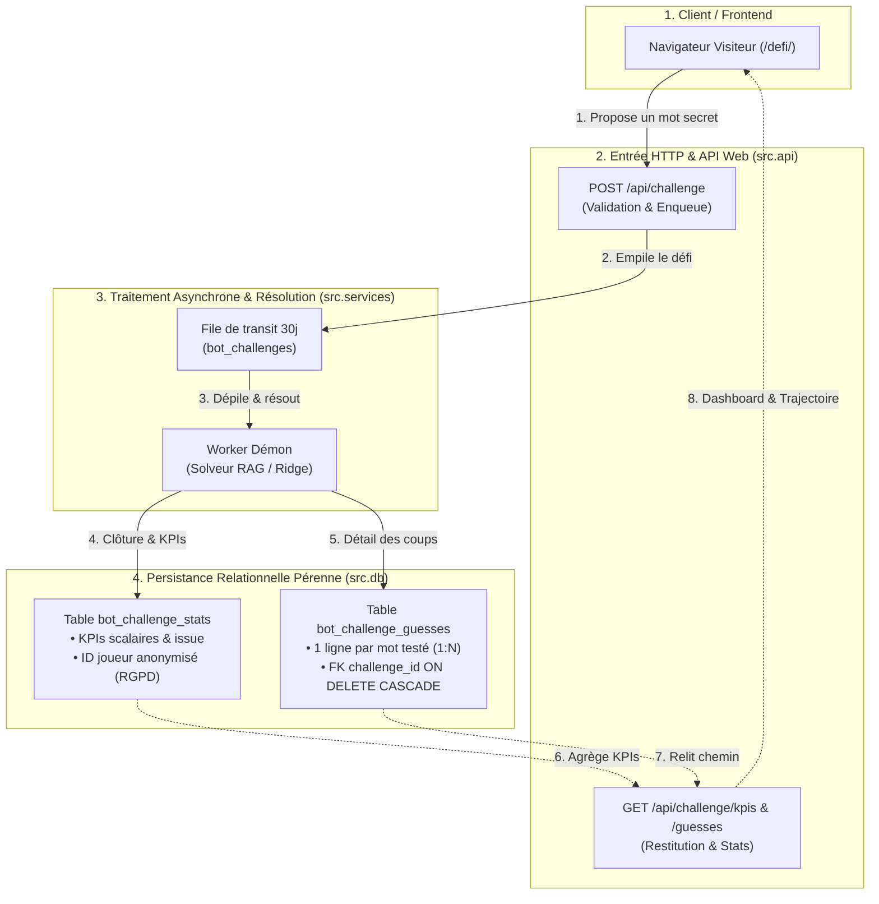

# Jalon M8 — Traçage en BDD & Métriques KPI des Défis Visiteurs (bot_challenge_stats)

**Dépôt :** `Cyrilpop/cemantix-rag-solver`  
**Branche visée :** `feature/m8-defi-kpi-analytics` (base `origin/main`)  
**Statut :** Spécification technique & contrat d'implémentation (Idempotent / Multi-Dialecte / RGPD)  
**Périmètre exclusif :** Schémas DDL (`database/init.sql`, `src/db/connection.py`), couche d'accès aux données (`src/db/challenges.py` ou module dédié), endpoint API REST (`src/api/routes/challenge.py`), interface visiteur (`volumes/web/defi/index.html`, `volumes/web/js/defi.js`), suite de tests unitaires (`tests/test_challenge_kpis.py`) et documentation associée.  
**Suite de validation requise :** Tests unitaires sous Docker Python 3.12, `tools/check_docs.py`, `tools/check_seo.py`, `tools/build_css_bundles.py --check`.

---

## 1. Objectifs Métier et KPIs Cibles

La page `/defi/` permet aux visiteurs d'imposer un mot secret au solveur RAG et de suivre en direct sa résolution.  
Actuellement, la table de transit `bot_challenges` gère la file d'attente et la trajectoire temps réel mais est purgée automatiquement tous les 30 jours (directive RGPD `SEC-27`). De plus, aucune vue analytique consolidée n'est calculée ni exposée.

Ce jalon introduit la persistance analytique pérenne, légère et anonymisée de chaque défi visiteur afin d'alimenter les indicateurs clés de performance (KPIs) suivants :

1. **Volume d'activité :** Nombre total de défis soumis, complétés et répartition chronologique.
2. **Performance de l'IA (Taux de victoire / défaite) :**
   - Victoire de l'IA : le bot trouve le mot secret en $\le 100$ coups (`outcome = 'won'`).
   - Victoire du visiteur : le bot cale ou atteint le plafond de 100 coups sans trouver (`outcome = 'lost'`).
   - Ratios calculés : `% de réussite du bot` vs `% de défis remportés par les visiteurs`.
3. **Distribution du nombre de coups :** Nombre moyen de coups, minimum, maximum et médiane des résolutions.
4. **Palmarès des mots joués :**
   - Mots les plus fréquemment proposés par les visiteurs.
   - Mots les plus coriaces / invaincus (qui ont mis le bot en échec).
5. **Scoreboard visiteur anonymisé :**
   - Génération d'un pseudonyme éphémère non traçable (`Visiteur #a1b2`) dérivé de l'empreinte salée HMAC.
   - Statistiques personnelles sur la session courante (ex: « Vous : 2 victoires / 3 défis lancés »).

---

## 2. Invariants Opérationnels & Architecture Cible

### 2.1 Synthèse de l'Architecture & du Flux



### 2.2 Règles d'Or & Invariants

1. **Idempotence Absolue du DDL :**
   - Le script `database/init.sql` doit pouvoir être exécuté plusieurs fois sans erreur (`CREATE TABLE IF NOT EXISTS`, `CREATE INDEX IF NOT EXISTS`).
   - Aucune modification destructive de la table existante `bot_challenges`.
2. **Double Dialecte Obligatoire :**
   - Tout schéma DDL et toute requête SQL doivent être compatibles avec **PostgreSQL 16** (production) et **SQLite 3** (suite de tests unitaires locaux).
   - Utilisation de `SERIAL` sous PostgreSQL et `INTEGER PRIMARY KEY AUTOINCREMENT` sous SQLite.
3. **Respect Strict du RGPD & Anonymisation :**
   - Aucune adresse IP brute ne doit être stockée dans la table de statistiques.
   - L'identifiant joueur stocké `player_anon_id` doit être une empreinte à sens unique (hash salé irréversible tronqué), interdisant toute réidentification.
4. **Exécution Exclusive sous Docker :**
   - Aucun script Python ni migration SQL ne doit être exécuté directement sur l'hôte. Toute commande s'exécute dans le conteneur Docker officiel Python 3.12.

---

## 3. Spécification du Schéma DDL (Infrastructure as Code)

### 3.1 Cible PostgreSQL : `database/init.sql`
Ajout de la section 6 à la fin de `database/init.sql` :

```sql
-- 6. Table analytique pérenne des défis visiteurs (M8 - KPIs & Traçage)
CREATE TABLE IF NOT EXISTS bot_challenge_stats (
    id               SERIAL PRIMARY KEY,
    challenge_id     VARCHAR(32) NOT NULL UNIQUE,
    secret_word      VARCHAR(64) NOT NULL,
    player_anon_id   VARCHAR(32) NOT NULL,
    outcome          VARCHAR(16) NOT NULL, -- 'won', 'lost', 'error'
    tries_count      INT NOT NULL DEFAULT 0,
    duration_seconds NUMERIC(8, 2),
    created_at       TIMESTAMPTZ NOT NULL DEFAULT CURRENT_TIMESTAMP
);
CREATE INDEX IF NOT EXISTS idx_bot_challenge_stats_word ON bot_challenge_stats(secret_word);
CREATE INDEX IF NOT EXISTS idx_bot_challenge_stats_player ON bot_challenge_stats(player_anon_id);
CREATE INDEX IF NOT EXISTS idx_bot_challenge_stats_outcome ON bot_challenge_stats(outcome);
CREATE INDEX IF NOT EXISTS idx_bot_challenge_stats_created ON bot_challenge_stats(created_at);

-- 7. Table relationnelle normalisée du chemin de résolution (M8 - Trajectoire de l'IA)
CREATE TABLE IF NOT EXISTS bot_challenge_guesses (
    id           SERIAL PRIMARY KEY,
    challenge_id VARCHAR(32) NOT NULL REFERENCES bot_challenge_stats(challenge_id) ON DELETE CASCADE,
    step_num     INT NOT NULL,
    word         VARCHAR(64) NOT NULL,
    score        NUMERIC(6, 2) NOT NULL,
    permille     INT,
    weather      VARCHAR(8),
    is_record    BOOLEAN DEFAULT FALSE,
    source       VARCHAR(16) DEFAULT 'rag',
    created_at   TIMESTAMPTZ NOT NULL DEFAULT CURRENT_TIMESTAMP,
    UNIQUE(challenge_id, step_num)
);
CREATE INDEX IF NOT EXISTS idx_bcg_challenge ON bot_challenge_guesses(challenge_id);
CREATE INDEX IF NOT EXISTS idx_bcg_word ON bot_challenge_guesses(word);
```

### 3.2 Cible Multi-Dialecte : `src/db/connection.py`
Mise à jour des constantes globales `PG_SCHEMA` et `SQLITE_SCHEMA` :

- **Dans `PG_SCHEMA` :** Insérer les blocs PostgreSQL ci-dessus.
- **Dans `SQLITE_SCHEMA` :** Insérer les blocs SQLite équivalents :

```sql
CREATE TABLE IF NOT EXISTS bot_challenge_stats (
    id INTEGER PRIMARY KEY AUTOINCREMENT,
    challenge_id TEXT NOT NULL UNIQUE,
    secret_word TEXT NOT NULL,
    player_anon_id TEXT NOT NULL,
    outcome TEXT NOT NULL,
    tries_count INTEGER NOT NULL DEFAULT 0,
    duration_seconds REAL,
    created_at TEXT NOT NULL DEFAULT CURRENT_TIMESTAMP
);
CREATE INDEX IF NOT EXISTS idx_bot_challenge_stats_word ON bot_challenge_stats(secret_word);
CREATE INDEX IF NOT EXISTS idx_bot_challenge_stats_player ON bot_challenge_stats(player_anon_id);
CREATE INDEX IF NOT EXISTS idx_bot_challenge_stats_outcome ON bot_challenge_stats(outcome);
CREATE INDEX IF NOT EXISTS idx_bot_challenge_stats_created ON bot_challenge_stats(created_at);

CREATE TABLE IF NOT EXISTS bot_challenge_guesses (
    id INTEGER PRIMARY KEY AUTOINCREMENT,
    challenge_id TEXT NOT NULL REFERENCES bot_challenge_stats(challenge_id) ON DELETE CASCADE,
    step_num INTEGER NOT NULL,
    word TEXT NOT NULL,
    score REAL NOT NULL,
    permille INTEGER,
    weather TEXT,
    is_record BOOLEAN DEFAULT 0,
    source TEXT DEFAULT 'rag',
    created_at TEXT NOT NULL DEFAULT CURRENT_TIMESTAMP,
    UNIQUE(challenge_id, step_num)
);
CREATE INDEX IF NOT EXISTS idx_bcg_challenge ON bot_challenge_guesses(challenge_id);
CREATE INDEX IF NOT EXISTS idx_bcg_word ON bot_challenge_guesses(word);
```

---

## 4. Spécification de la Couche DAO (`src/db/challenges.py`)

### 4.1 Enregistrement Analytique (`record_challenge_stat`)
Lorsqu'un défi se termine (`finish_challenge`), une ligne statistique est enregistrée de manière atomique et idempotente :

```python
def anonymize_player_token(ip_hash_value: str) -> str:
    """Dérive un identifiant visiteur pseudonymisé et stable (ex: 'joueur_a1b2c3d4')."""
    token = hashlib.sha256(f"player_token|{ip_hash_value}".encode("utf-8")).hexdigest()[:10]
    return f"joueur_{token}"

def record_challenge_stat(
    challenge_id: str,
    secret_word: str,
    ip_hash_value: str,
    outcome: str,
    tries_count: int,
    duration_seconds: Optional[float] = None,
    created_at: Optional[datetime] = None,
) -> bool:
    """Enregistre un défi terminé dans les statistiques. Idempotent via ON CONFLICT DO NOTHING."""
    player_anon_id = anonymize_player_token(ip_hash_value)
    # Mapping outcome : 'solved' -> 'won', 'lost' -> 'lost', 'error' -> 'error'
    norm_outcome = "won" if outcome == "solved" else outcome
    created_val = created_at or _utcnow()

    query = """
    INSERT INTO bot_challenge_stats (
        challenge_id, secret_word, player_anon_id, outcome,
        tries_count, duration_seconds, created_at
    )
    VALUES (%s, %s, %s, %s, %s, %s, %s)
    ON CONFLICT (challenge_id) DO NOTHING;
    """
    db.execute(
        query,
        (
            str(challenge_id),
            str(secret_word),
            str(player_anon_id),
            str(norm_outcome),
            int(tries_count),
            float(duration_seconds) if duration_seconds is not None else None,
            created_val,
        ),
    )
    return True

def save_challenge_guesses(challenge_id: str, guesses: list[dict]) -> int:
    """Enregistre les coups du chemin en base relationnelle avec ON CONFLICT DO NOTHING."""
    if not guesses:
        return 0
    query = """
    INSERT INTO bot_challenge_guesses (
        challenge_id, step_num, word, score, permille, weather, is_record, source
    )
    VALUES (%s, %s, %s, %s, %s, %s, %s, %s)
    ON CONFLICT (challenge_id, step_num) DO NOTHING;
    """
    inserted = 0
    with db.transaction() as conn:
        for g in guesses:
            q, p = db._format_query(query, (
                str(challenge_id),
                int(g.get("step") or g.get("step_num") or 0),
                str(g["word"]),
                float(g["score"]),
                int(g["permille"]) if g.get("permille") is not None else None,
                str(g.get("weather") or "")[:8] or None,
                bool(g.get("is_record", False)),
                str(g.get("source") or "rag")[:16],
            ), db._determine_engine())
            conn.execute(q, p)
            inserted += 1
    return inserted

def get_challenge_guesses(challenge_id: str) -> list[dict]:
    """Relit le cheminement complet ordonné pour un défi donné."""
    query = "SELECT * FROM bot_challenge_guesses WHERE challenge_id = %s ORDER BY step_num ASC;"
    return db.fetch_all(query, (str(challenge_id),))
```

### 4.2 Calcul et Agrégation des KPIs (`get_challenge_kpis`)
Fournit les métriques globales et les métriques filtrées par visiteur :

```python
def get_challenge_kpis(player_ip_hash: Optional[str] = None) -> dict:
    """Retourne la synthèse des KPIs globaux et les stats de la session courante."""
    # 1. Totaux et victoires/défaites globales
    # 2. Moyenne et médiane de coups
    # 3. Top mots joués (les 5 plus fréquents)
    # 4. Mots coriaces (défis remportés par les visiteurs)
    # 5. Derniers défis anonymisés
    # 6. Statistiques du visiteur courant (si player_ip_hash renseigné)
```

---

## 5. Spécification de l'API REST HTTP (`src/api/routes/challenge.py`)

### 5.1 Endpoint `GET /api/challenge/kpis`
Permet au frontend d'interroger les indicateurs statistiques en temps réel.

- **Requête :** `GET /api/challenge/kpis`
- **Sécurité :** Extraction de l'IP appelante via `extract_client_ip(environ)` et hachage salé standard pour isoler ses stats de visiteur sans exposer d'adresse IP.
- **Réponse HTTP 200 (JSON) :**

```json
{
  "status": "ok",
  "global": {
    "total_challenges": 142,
    "bot_wins": 118,
    "bot_losses": 24,
    "bot_win_rate_pct": 83.1,
    "player_win_rate_pct": 16.9,
    "avg_tries": 34.2,
    "min_tries": 4,
    "max_tries": 98,
    "top_words": [
      {"word": "pomme", "count": 12, "bot_wins": 10},
      {"word": "ordinateur", "count": 8, "bot_wins": 7}
    ],
    "tough_words": [
      {"word": "alambic", "tries": 100, "date": "2026-11-04"}
    ],
    "recent_activity": [
      {
        "player": "Visiteur #a1b2",
        "word": "banane",
        "outcome": "won",
        "tries": 18,
        "duration_seconds": 3.4,
        "date": "2026-11-04T21:40:00Z"
      }
    ]
  },
  "player": {
    "identified": true,
    "display_name": "Visiteur #a1b2",
    "total_played": 3,
    "player_wins": 1,
    "player_losses": 2,
    "player_win_rate_pct": 33.3
  }
}
```

---

## 6. Spécification Frontend (`volumes/web/defi/`)

### 6.1 Balisage HTML (`volumes/web/defi/index.html`)
Insertion d'une section analytique après le formulaire de défi :

1. **Barre de KPIs en grille :**
   - Carte 1 : 🤖 Victoires IA (%)
   - Carte 2 : ⚔️ Total Défis Joués
   - Carte 3 : 🎯 Coups Moyens
   - Carte 4 : 🏆 Mots Invaincus par l'IA
2. **Encadré visiteur personnalisé :**
   - Affiche le badge anonymisé (`Visiteur #a1b2`) et son ratio personnel contre l'IA.
3. **Tableau des derniers défis communautaires :**
   - Mot joué, coups requis, durée, résultat visuel (`⭐ Trouvé` ou `🛡️ Victoire Joueur`).

### 6.2 Contrôleur JavaScript (`volumes/web/js/defi.js`)
- Appel automatique de `/api/challenge/kpis` au chargement de la page.
- Rafraîchissement automatique des KPIs à la réception du statut terminal (`solved` ou `lost`).
- Échappement systématique des données via `escapeHtml()`.

---

## 7. Plan de Test et Commandes de Contrôle

### 7.1 Tests Unitaires (`tests/test_challenge_kpis.py`)
1. **Idempotence DDL :** Exécution répétée de l'initialisation du schéma sur base SQLite éphémère.
2. **Insertion & Dédoublonnage :** Vérification qu'un même `challenge_id` ne produit aucun doublon (`ON CONFLICT DO NOTHING`).
3. **Calcul des KPIs :** Validation unitaire des calculs de moyennes, taux de victoire (%) et regroupements `GROUP BY`.
4. **Anonymisation :** Contrôle qu'aucune IP n'apparaît dans les payloads renvoyés par l'API.

### 7.2 Commandes de Validation Docker

```bash
# 1. Exécution de la suite complète de tests (353+ tests attendus au vert)
docker run --rm -v $(pwd):/app -w /app python:3.12-slim sh -c \
  "pip install --no-cache-dir -r requirements.txt && python -m unittest discover -s tests -v"

# 2. Contrôle de cohérence documentaire
python tools/check_docs.py

# 3. Contrôle du balisage SEO & métadonnées
python tools/check_seo.py

# 4. Contrôle des bundles CSS
python tools/build_css_bundles.py --check
```

