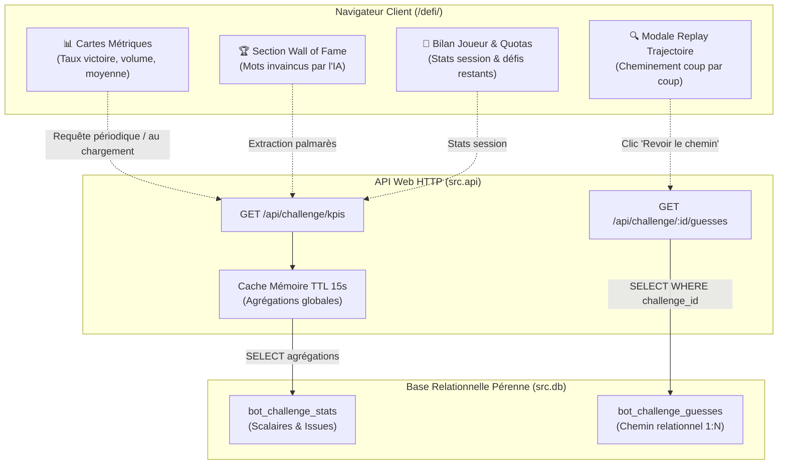

# Jalon M9 — Wall of Fame, Exploitation des KPIs & Visualisation Interactive des Défis

**Dépôt :** `Cyrilpop/cemantix-rag-solver`  
**Branche visée :** `feature/m9-wall-of-fame-ui` (base `origin/main`)  
**Statut :** Spécification technique & contrat d'implémentation Frontend / UX / API  
**Socle de données prérequis :** [Jalon M8 (`bot_challenge_stats` et `bot_challenge_guesses`)](M8_DEFI_ANALYTICS_KPIS.md)  
**Périmètre exclusif :** Interface utilisateur ([`volumes/web/defi/index.html`](../../volumes/web/defi/index.html), [`volumes/web/js/defi.js`](../../volumes/web/js/defi.js)), contrôleur d'API REST ([`src/api/routes/challenge.py`](../../src/api/routes/challenge.py)), stylisation CSS ([`volumes/web/css/dist/`](../../volumes/web/css/)), suite de tests unitaires ([`tests/test_challenge_routes.py`](../../tests/)) et documentation associée.  
**Suite de validation requise :** Tests unitaires sous Docker Python 3.12, `tools/check_docs.py`, `tools/check_seo.py`, `tools/build_css_bundles.py --check`.

---

## 1. Objectifs Métier & Expérience Visiteur

Le Jalon M8 a instauré la persistance pérenne en BDD de tous les défis et de chaque coup joué.  
Le présent **Jalon M9** transforme ces données brutes en une expérience interactive et communautaire sur la page `/defi/` à travers 4 fonctionnalités clés :

1. **Le « Wall of Fame » (Palmarès des Mots Invaincus) :**
   - Mise à l'honneur des mots qui ont mis le solveur RAG en échec (le bot n'a pas trouvé le mot dans la limite des 100 coups, `outcome = 'lost'`).
   - Valorisation du visiteur victorieux via son alias pseudonymisé (`Visiteur #a1b2`).
2. **Tableau de Bord & KPIs Communautaires en Direct :**
   - 4 cartes métriques en temps réel :
     * 🤖 **Taux de Victoire IA** (ex. 84,2 %)
     * ⚔️ **Défis Totaux Joués** (compteur cumulé pérenne)
     * 🎯 **Moyenne de Coups** (ex. 32,4 coups)
     * 🏆 **Mots au Wall of Fame** (nombre de mots ayant vaincu l'IA)
3. **Replay Interactif du Cheminement :**
   - Possibilité pour tout visiteur de cliquer sur un défi passé pour ouvrir la modale de trajectoire ([`volumes/web/js/trajectory.js`](../../volumes/web/js/trajectory.js)) et inspecter coup par coup comment l'IA a réfléchi.
4. **Bilan de Session & Gestion du Quota Visiteur :**
   - Bandeau personnalisé basé sur l'empreinte salée RGPD :  
     *« Bienvenue Visiteur #a1b2 — 2 victoires / 3 défis lancés (66 %) • 7 défis restants cette heure-ci »*.
5. **Performance & Cache TTL :**
   - Mise en cache mémoire de 15 secondes sur l'agrégation des KPIs côté API pour éliminer toute charge BDD en cas de fort trafic.

---

## 2. Architecture des Flux & Restitution



---

## 3. Spécification des Endpoints d'API REST

### 3.1 Endpoint `GET /api/challenge/kpis`
Fournit l'ensemble des données d'affichage pour la page `/defi/`.

- **Mise en cache :** Cache en mémoire avec TTL de 15 secondes pour le bloc `global` et `wall_of_fame`. Le bloc `player` est recalculé à la volée pour l'IP du visiteur.
- **Réponse HTTP 200 (JSON) :**

```json
{
  "status": "ok",
  "global": {
    "total_challenges": 158,
    "bot_wins": 132,
    "bot_losses": 26,
    "bot_win_rate_pct": 83.5,
    "player_win_rate_pct": 16.5,
    "avg_tries": 33.1,
    "wall_of_fame_count": 26
  },
  "wall_of_fame": [
    {
      "challenge_id": "9f8a7b6c5d4e3f21",
      "secret_word": "alambic",
      "player": "Visiteur #e4b1",
      "tries_count": 100,
      "duration_seconds": 12.4,
      "date": "2026-11-04T18:30:00Z"
    }
  ],
  "player": {
    "identified": true,
    "display_name": "Visiteur #a1b2",
    "total_played": 3,
    "player_wins": 1,
    "player_losses": 2,
    "player_win_rate_pct": 33.3,
    "quota_remaining": 7,
    "quota_max": 10
  }
}
```

### 3.2 Endpoint `GET /api/challenge/<id>/guesses`
Restitue la liste ordonnée des étapes pour la modale de visualisation.

- **Requête :** `GET /api/challenge/9f8a7b6c5d4e3f21/guesses`
- **Réponse HTTP 200 (JSON) :**

```json
{
  "status": "ok",
  "challenge_id": "9f8a7b6c5d4e3f21",
  "guesses_count": 100,
  "steps": [
    {
      "step": 1,
      "word": "pomme",
      "score": -6.47,
      "permille": 2,
      "weather": "😎",
      "is_record": false,
      "source": "seed"
    },
    {
      "step": 2,
      "word": "arbre",
      "score": 8.37,
      "permille": 7,
      "weather": "😎",
      "is_record": true,
      "source": "seed"
    }
  ]
}
```

---

## 4. Spécification de l'Interface Utilisateur (`volumes/web/defi/`)

### 4.1 Nouveaux Composants HTML (`index.html`)

1. **Bandeau Statut & Quota Joueur (`#defi-player-banner`) :**
   - Situé au-dessus du formulaire de saisie.
   - Présente le badge anonyme du joueur, son historique de session et ses crédits horaires restants.
2. **Grille de KPIs Communautaires (`#defi-kpi-grid`) :**
   - 4 cartes avec compteurs animés et icônes thématiques (`🤖 Victoire IA`, `⚔️ Défis Joués`, `🎯 Coups Moyens`, `🏆 Wall of Fame`).
3. **Le Wall of Fame (`#defi-wall-of-fame`) :**
   - Liste des derniers mots ayant triomphé du bot.
   - Bouton d'action direct : *"👁️ Revoir le chemin"* ouvrant la modale de trajectoire.

### 4.2 Contrôleur JavaScript (`volumes/web/js/defi.js`)
- Chargement asynchrone des KPIs au `DOMContentLoaded`.
- Événement `challenge_completed` : rafraîchissement immédiat du Wall of Fame et du bandeau joueur dès que le défi en cours se termine.
- Branchement du modal universel `openTrajectoryModal()` pour rejouer n'importe quel défi archivé.
- Échappement systématique des chaînes via `escapeHtml()`.

---

## 5. Plan de Test et Validation Docker

### 5.1 Tests Unitaires & Intégration (`tests/test_challenge_ui_api.py`)
1. **Validation du Cache TTL :** Vérification qu'un deuxième appel consécutif à `/api/challenge/kpis` ne sollicite pas la BDD.
2. **Extraction du Wall of Fame :** Vérification que seuls les défis `outcome = 'lost'` apparaissent au Wall of Fame.
3. **Restitution des Coups :** Contrôle de conformité de `/api/challenge/<id>/guesses`.
4. **Quota Joueur :** Contrôle de la cohérence de `quota_remaining` dans le payload joueur.

### 5.2 Commandes de Validation Docker

```bash
# 1. Tests unitaires complets
docker run --rm -v $(pwd):/app -w /app python:3.12-slim sh -c \
  "pip install --no-cache-dir -r requirements.txt && python -m unittest discover -s tests -v"

# 2. Contrôle de cohérence documentaire
python tools/check_docs.py

# 3. Contrôle du balisage SEO & accessibilité
python tools/check_seo.py

# 4. Contrôle et compilation des bundles CSS
python tools/build_css_bundles.py --check
```

