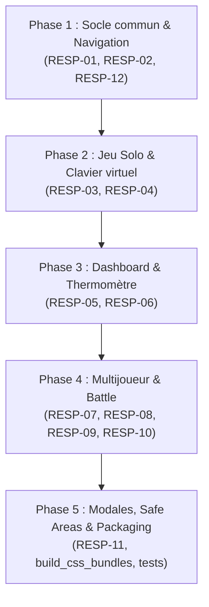

# 📱 Plan de Refonte Responsive & Ergonomie Mobile (Smartphones)

> **Évolution :** [2026-10 · Responsive mobile](../README.md) · document 1/2
> **Statut du document :** référence de conception, versionnée.
> **Avancement :** tenu à jour séparément dans [`02-avancement.md`](02-avancement.md) — ne pas reporter d'état d'avancement ici, ce fichier décrit **quoi faire et comment le vérifier**.
> **Branche de travail visée :** `feat/responsive-mobile`
> **Base de référence :** `origin/main` @ `4019126`
> **Date de conception :** 29/10/2026
> **Périmètre exclusif :** styles CSS mobiles (`@media (max-width: 768px)` et breakpoints smartphone) et adaptation ergonomique des gabarits HTML sans modification de l'affichage bureau (Desktop 100 % préservé).

**Convention de lecture :** chaque finding porte un identifiant permanent (`RESP-01` à `RESP-12`) utilisé comme **clé de suivi** dans `02-avancement.md`. Un ID ne change jamais et n'est jamais réattribué, même après abandon (statut `Renoncé` dans le suivi).

---

## 0. Méthodologie, périmètre & appareils cibles

### 0.1 Périmètre couvert

Le chantier cible l'intégralité de l'expérience utilisateur sur smartphone, avec une attention particulière aux écrans modernes à ratio allongé (20:9) et claviers virtuels actifs.

| Zone | Fichiers CSS sources | Fichiers HTML / Vues |
|---|---|---|
| Structure & Navigation globale | `volumes/web/css/base.css`, `layout.css` | Toutes (`index.html`, `play/`, `battle/`, `multi/`, `puzzles/`) |
| Dashboard & Mot du Jour | `volumes/web/css/dashboard.css` | `volumes/web/index.html` |
| Jeu Solo (Mode Illimité & Défi) | `volumes/web/css/game.css` | `volumes/web/play/index.html` |
| Mode Battle (Versus IA) | `volumes/web/css/battle.css` | `volumes/web/battle/index.html` |
| Mode Multijoueur 1v1 | `volumes/web/css/multi.css` | `volumes/web/multi/index.html` |
| Modales & Dialogues | `volumes/web/css/modal.css` | Partagé |
| Compilation & Bundling | `tools/build_css_bundles.py` | `volumes/web/css/dist/*.css` |

### 0.2 Profils matériels et résolutions étalons

Les ajustements sont conçus et qualifiés sur les résolutions de référence suivantes :

1. **Google Pixel 8 Pro (GP8 Pro - terminal de signalement)** : Viewport CSS de **412 × 915 px** (DPR 3.5), ratio 20:9, clavier Android Gboard (~330 px de haut).
2. **Standard Android moderne** : Viewport CSS de **390 × 844 px** à **412 × 892 px**.
3. **iPhone récents (14/15/16 Pro)** : Viewport CSS de **393 × 852 px** (Dynamic Island, barre de navigation Safari basse).
4. **Petits smartphones compacts (contrainte maximale)** : Viewport CSS de **360 × 740 px** (Samsung Galaxy A series, anciens modèles).

---

## 1. Synthèse du diagnostic & causes racines

L'analyse des retours utilisateurs et des captures d'écran sur smartphone révèle plusieurs dysfonctionnements majeurs d'ergonomie et de débordement :

```text
Captures Utilisateur (GP8 Pro) ➔ Diagnostic Technique :
1. Header / Onglets    ➔ "Tableau de Bord" rogné en "de Bord" : flex avec justify-content: center déborde à gauche.
2. Formulaire Solo     ➔ Champ de saisie écrasé à "ex: mai" : input + tester + 2 boutons latéraux sur la même ligne.
3. Clavier Virtuel     ➔ Clavier Gboard ouvert : masque la zone active, boîte Top 10 à hauteur rigide (260px).
4. Stats Dashboard     ➔ 3 colonnes de métriques comprimées à l'extrême (< 115px par carte).
5. Lobby Multijoueur   ➔ Onglets "Créer / Rejoindre / Duels" superposés avec scrollbar horizontale disgracieuse.
6. Sélecteurs radio    ➔ Boutons de difficulté coupés au bas de l'écran par manque de marge safe-area.
```

### 1.1 Causes racines identifiées

1. **Le piège du débordement gauche sur flexbox centré (`scroll-overflow-loss`) :**
   Dans `layout.css`, `.nav-tabs` hérite de `justify-content: center`. Dès que la somme de la largeur des 5 onglets dépasse la largeur de l'écran (~600 px requis vs 412 px disponibles sur GP8 Pro), le navigateur centre le bloc et pousse la partie gauche hors champ (coordonnées négatives non atteignables au scroll). Résultat : « Tableau de Bord » devient « de Bord ».
2. **Encombrement excessif sur une seule ligne (`.guess-form-row`) :**
   Dans `game.css`, l'input textuel, le bouton principal « Tester ↵ » et deux boutons secondaires verticaux (« 💡 Indice », « 🚩 Abandonner ») partagent une rangée unique. Sur un écran de 412 px, le champ texte est asphyxié.
3. **Absence de gestion de la hauteur dynamique avec clavier virtuel :**
   Lors de la saisie sur mobile, le clavier virtuel réduit l'espace vertical utile à moins de 400 px. Les hauteurs fixes en pixels (`height: 260px`) forcent des ascenseurs verticaux imbriqués et font disparaître le mot testé sous le pli du clavier.
4. **Rigidité des largeurs minimales dans le lobby multi (`multi.css`) :**
   `.lobby-tab-btn` impose `min-width: 130px; flex: 1; white-space: nowrap;` sans gestion propre du scroll snap, créant des artefacts visuels et des chevauchements de libellés.
5. **Garantie d'intégrité Desktop :**
   Tous les correctifs doivent être encapsulés sous les requêtes médias `@media (max-width: 768px)` et `@media (max-width: 480px)` afin de ne pas modifier le rendu sur ordinateur.

---

## 2. Matrice des chantiers & findings permanents

| # | Sév. | Composant | Problème constaté | Correctif spécifié | Critère de vérification |
|---|---|---|---|---|---|
| **RESP-01** | 🟠 | Layout / Header | Header étroit avec risque de repli brutal du titre et des actions (`layout.css:69-106`) | Titre compact, taille d'icône fluide, boutons d'actions tactiles 44px min sans wrap | Aucun débordement à 360px, header stable sur 1 ligne |
| **RESP-02** | 🔴 | Navigation Vues | « Tableau de Bord » tronqué en « de Bord » à gauche (`layout.css:154-260`) | Barre d'onglets mobile défilante fluide (`overflow-x: auto`, `justify-content: flex-start`, masquage scrollbar, libellés courts optionnels) | Tous les 5 onglets accessibles sans troncature à 360px |
| **RESP-03** | 🔴 | Jeu Solo / Saisie | Champ de saisie écrasé par les boutons latéraux sur GP8 Pro (`game.css:210-250`) | Passer en disposition étagée sur mobile : Ligne 1 = champ + bouton Tester ; Ligne 2 = boutons Indice & Abandonner pleine largeur | Champ texte d'au moins 240px de large à 390px de viewport |
| **RESP-04** | 🟠 | Clavier Virtuel | Boîte Top 10 rigide (260px) poussant l'écran lors de la saisie (`game.css:710-714`) | Utiliser des unités `dvh` / `svh`, réduire la hauteur des listes lors du focus clavier | Le champ et le dernier score restent visibles clavier ouvert |
| **RESP-05** | 🟡 | Dashboard / Stats | 3 colonnes de métriques trop étroites (<115px) sous le mot secret (`dashboard.css:270-320`) | Grille responsive : 3 colonnes au-dessus de 480px, bascule en 1 ou 2 colonnes ergonomiques sous 400px | Textes des métriques et liens lisibles sans troncature |
| **RESP-06** | 🟡 | Thermomètre | Paliers thermiques (`<0°C`, `>30°C`) trop serrés sur la jauge (`dashboard.css:330-356`) | Jauge thermique fluide, pastilles avec police auto-ajustée et espacement respirant | Les 5 paliers sont distincts et lisibles à 360px |
| **RESP-07** | 🔴 | Lobby Multi | Onglets « Créer / Rejoindre / Duels » superposés et tronqués (`multi.css:35-85`) | `.lobby-nav` avec `justify-content: flex-start`, libellés concis sur mobile (« Créer », « Rejoindre », « En cours »), scroll-snap | Zéro chevauchement de texte sur 360px et 412px |
| **RESP-08** | 🟠 | Variantes Multi | Cartes de sélection de variante (« Même Mot », « Mots Choisis ») volumineuses (`multi.css:89-172`) | Cartes compactes sur mobile, padding réduit (1rem), flex vertical net | Les deux cartes s'affichent proprement sans débordement horizontal |
| **RESP-09** | 🟠 | Formulaires Multi | Sélecteur de difficulté (Facile / Moyen / Expert) collé en bas sans marge (`multi.css:257-260`) | Ajout de padding de respiration et prise en compte de `env(safe-area-inset-bottom)` | Sélecteur entièrement visible au-dessus du footer |
| **RESP-10** | 🟠 | Mode Battle | Scoreboard joueur/IA et historique de confrontation à l'étroit (`battle.css:37-100`) | Réagencement du HUD en bandeau vertical compact, scores bien identifiés | Confort visuel lors du duel contre l'IA sur écran 412px |
| **RESP-11** | 🟡 | Modales & Cibles | Cibles tactiles trop petites ou modales débordant verticalement (`modal.css:1-120`) | Modales mobile-first (bottom sheet ou plein écran adaptatif), boutons tactiles ≥ 44px | Modale d'abandon et d'aide utilisables à une main |
| **RESP-12** | 🔴 | Global Overflow | Débordement horizontal global de la page (barre de défilement parasite) | `overflow-x: hidden` strict sur `body/html` et détection préventive de tout conteneur à largeur fixe | `document.documentElement.scrollWidth === window.innerWidth` |

---

## 3. Spécifications détaillées par composant

### 3.1 Header & Navigation principale (RESP-01, RESP-02)
- **Fichier impacté :** `volumes/web/css/layout.css`
- **Comportement Desktop :** Centré, espacé, badges visibles (aucun changement).
- **Comportement Mobile (< 768px) :**
  - Remplacer `justify-content: center` par `justify-content: flex-start` sur `.nav-tabs` pour bannir la troncature gauche.
  - Activer le défilement horizontal fluide : `overflow-x: auto; scrollbar-width: none; -webkit-overflow-scrolling: touch;`.
  - Appliquer `scroll-snap-type: x mandatory` sur le conteneur et `scroll-snap-align: start` sur les onglets.
  - Maintenir un padding latéral de 8px pour que le premier et le dernier onglet ne touchent pas le bord de l'écran.
  - Ajouter un indicateur d'ombre ou dégradé subtil à droite pour signaler la suite des onglets si l'écran est très étroit.

### 3.2 Formulaire de jeu & Clavier virtuel (RESP-03, RESP-04)
- **Fichiers impactés :** `volumes/web/css/game.css`, `volumes/web/css/battle.css`
- **Comportement Desktop :** Ligne unique avec champ + Tester + boutons verticaux à droite.
- **Comportement Mobile (< 640px) :**
  - Transformer `.guess-form-row` en conteneur vertical :
    ```css
    @media (max-width: 640px) {
      .guess-form-row {
        flex-direction: column;
        gap: 0.6rem;
      }
      .guess-side-actions {
        flex-direction: row;
        width: 100%;
        gap: 0.5rem;
      }
      .guess-side-actions .btn {
        flex: 1;
        min-height: 40px;
        font-size: 0.85rem;
      }
    }
    ```
  - Le champ texte (`.input-wrapper`) bénéficie ainsi de 100 % de la largeur du conteneur.
  - Le placeholder « Entrez un mot français... » dispose d'un espace suffisant sans être tronqué.
  - Les boutons « 💡 Indice » et « 🚩 Abandonner » se partagent équitablement la ligne inférieure, avec une taille de touche tactile ergonomique pour les pouces.

### 3.3 Dashboard, Métriques & Thermomètre (RESP-05, RESP-06)
- **Fichier impacté :** `volumes/web/css/dashboard.css`
- **Comportement Desktop :** 3 colonnes alignées sous le mot secret.
- **Comportement Mobile (< 480px) :**
  - Réagencement de `.metrics-grid` : passer à 1 colonne centrée ou grille 2 colonnes + 1 pleine largeur pour conserver des textes lisibles.
  - Polices et pastilles de l'échelle thermique adaptées avec `clamp()` ou pourcentages souples pour éviter les débordements de texte.

### 3.4 Lobby & Salles Multijoueur (RESP-07, RESP-08, RESP-09)
- **Fichier impacté :** `volumes/web/css/multi.css`
- **Comportement Mobile (< 768px) :**
  - `.lobby-nav` : `overflow-x: auto; scrollbar-width: none; justify-content: flex-start; gap: 0.35rem;`.
  - `.lobby-tab-btn` : supprimer le `min-width: 130px` forcé et adapter la taille de police et les marges.
  - `.mode-cards-grid` : `grid-template-columns: 1fr;` en dessous de 600px pour empiler proprement « Même Mot » et « Mots Choisis ».
  - Safe-area en bas de page pour laisser respirer le bouton de création et les sélecteurs de difficulté.

---

## 4. Règle d'or : Non-régression absolue du Desktop

Pour honorer la directive utilisateur (*« Bien sur, la partie bureau on n'y touche pas, que la partie affichage sur mobile »*), les contraintes suivantes sont impératives :

1. **Aucune modification des sélecteurs racine non scopés :**
   Les styles par défaut (desktop) situés hors des blocs `@media` ne doivent subir aucune modification de disposition (grid, flex-direction, dimensions).
2. **Encapsulation stricte sous Media Queries :**
   Toutes les adaptations doivent être déclarées au sein de blocs :
   - `@media (max-width: 768px)` (tablettes et smartphones)
   - `@media (max-width: 480px)` (smartphones étroits)
3. **Validation visuelle croisée :**
   Contrôle systématique à 1440px (Desktop), 1024px (Laptop), 412px (GP8 Pro) et 360px (Mobile compact).

---

## 5. Plan d'exécution par phases



- **Phase 1 — Socle commun & Navigation globale :**
  - Résoudre le débordement horizontal général (`RESP-12`).
  - Corriger `.nav-tabs` pour bannir la troncature gauche sur smartphone (`RESP-02`).
  - Ajuster le header et les actions tactiles (`RESP-01`).
- **Phase 2 — Jeu Solo & Clavier virtuel :**
  - Réagencer `.guess-form-row` en 2 lignes ergonomiques sur mobile (`RESP-03`).
  - Ajuster les hauteurs et scrollbars adaptatives pour le clavier virtuel Android/iOS (`RESP-04`).
- **Phase 3 — Dashboard, Métriques & Thermomètre :**
  - Réorganiser la grille de statistiques du mot secret (`RESP-05`).
  - Ajuster l'échelle thermique et le compte à rebours (`RESP-06`).
- **Phase 4 — Multijoueur & Mode Battle :**
  - Corriger la sous-navigation du lobby multi (`RESP-07`).
  - Adapter les cartes de jeu et sélecteurs de difficulté (`RESP-08`, `RESP-09`).
  - Ajuster le HUD du Mode Battle (`RESP-10`).
- **Phase 5 — Modales, Safe Areas & Recette :**
  - Optimiser les dialogues et marges `safe-area-inset` (`RESP-11`).
  - Recompiler les bundles CSS de production via `tools/build_css_bundles.py`.
  - Exécuter la suite de tests et valider le non-débordement sous viewports mobiles.

---

## 6. Critères de qualification & outillage

1. **Rebuild des bundles CSS :**
   ```bash
   python tools/build_css_bundles.py
   python tools/build_css_bundles.py --check
   ```
2. **Exécution des tests automatisés :**
   ```bash
   docker compose run --rm -v ./tests:/app/tests --entrypoint python cemantix -m unittest discover -s tests
   ```
3. **Audit de non-débordement horizontal (Zero Horizontal Scrollbar) :**
   Script d'audit automatisé validant sur chaque page HTML que :
   - `scrollWidth <= clientWidth` sur des viewports simulés de 360px, 390px, 412px.
   - Aucun élément n'a de coordonnées négatives `left < 0` au repos.

