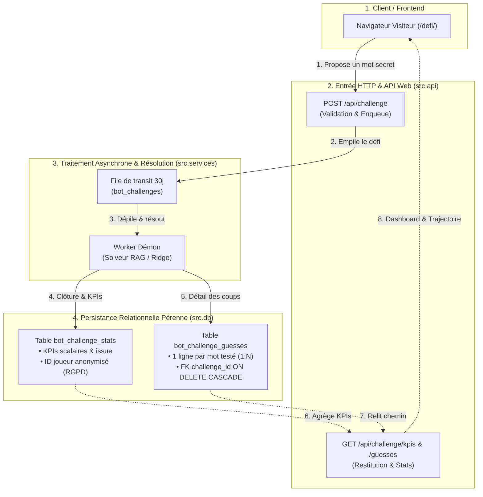

# 📈 Plan — Traçage en BDD & Métriques KPI des Défis Visiteurs

> **Évolution :** [2026-11 · Traçage & KPIs des Défis Visiteurs](../README.md) · document 1/2  
> **Statut du document :** référence de conception, versionnée.  
> **Avancement :** tenu à jour séparément dans [`02-avancement.md`](02-avancement.md) — ne pas reporter d'état d'avancement ici, ce fichier décrit **quoi faire et comment le vérifier**.  
> **Jalon technique associé :** [`docs/milestones/M8_DEFI_ANALYTICS_KPIS.md`](../../milestones/M8_DEFI_ANALYTICS_KPIS.md)  
> **Branche :** `feature/m8-defi-kpi-analytics` (base `origin/main`)  
> **Date d'ouverture :** 04/11/2026  

**Convention de lecture :** chaque action porte un identifiant permanent (`KPI-01` à `KPI-06`) utilisé comme **clé de suivi** dans `02-avancement.md`.

---

## 0. Méthodologie & périmètre

Le mode « Défier le bot » (`volumes/web/defi/index.html`) permet aux visiteurs d'éprouver l'IA en direct en imposant un mot secret. Actuellement, les défis passent par une table de transit (`bot_challenges`) purgée après 30 jours, sans agrégation des performances ni retour d'expérience statistique pour la communauté.

Cette évolution met en place un traçage persistant, idempotent et respectueux du RGPD pour enregistrer et restituer les indicateurs clés (KPIs) des défis lancés par les visiteurs :
1. Mots joués et fréquence d'apparition.
2. Nombre de coups nécessaires à la résolution (moyenne, min, max).
3. Ratios et pourcentages de victoire de l'IA face aux joueurs.
4. Identifiant visiteur pseudonymisé (`Visiteur #XXXX`) garantissant l'anonymat strict.
5. Exposition via API REST et affichage sur la page `/defi/`.

### 0.2 Synthèse de l'Architecture & du Flux

---

## 1. Findings & Actions Spécifiées

### KPI-01 (🔴) — Schéma DDL Idempotent & Double Dialecte (PostgreSQL / SQLite)
- **Problème :** `bot_challenges` ne conserve pas l'historique au-delà de 30 jours et stocke une trajectoire brute non normalisée.
- **Correctif :** Création de la table légère `bot_challenge_stats` (scalaires KPI) et de la table relationnelle normalisée `bot_challenge_guesses` (un coup par ligne, clé étrangère `challenge_id`, index sur `word` et `challenge_id`) dans `database/init.sql` (PostgreSQL) et `src/db/connection.py` (`PG_SCHEMA` et `SQLITE_SCHEMA`).
- **Vérification :** Initialisation sans erreur sur PostgreSQL et SQLite (`CREATE TABLE IF NOT EXISTS`, `CREATE INDEX IF NOT EXISTS`).

### KPI-02 (🔴) — Pseudonymisation RGPD & Masquage de l'ID Joueur
- **Problème :** Interdiction légale et éthique de tracer les adresses IP directes des visiteurs.
- **Correctif :** Fonction `anonymize_player_token()` dérivant un hash salé irréversible tronqué (`joueur_a1b2c3d4`) et un libellé convivial public (`Visiteur #a1b2`), empêchant toute rétro-ingénierie d'IP.
- **Vérification :** Test unitaire certifiant l'absence d'IP dans toute structure stockée ou retournée.

### KPI-03 (🟠) — Couche DAO d'Enregistrement Atomique & Idempotent
- **Problème :** Risque de doublons lors du re-jeu de tâches ou d'interruptions du démon worker.
- **Correctif :** Fonctions `record_challenge_stat()` et `save_challenge_guesses()` utilisant `INSERT ... ON CONFLICT DO NOTHING`, branchées dans `finish_challenge()`.
- **Vérification :** Deux appels consécutifs avec le même `challenge_id` ne produisent aucun doublon ni corruption en base.

### KPI-04 (🟠) — Moteur de Calcul & Agrégation des KPIs
- **Problème :** Nécessité d'agréger rapidement le volume total, le taux de victoire (%) de l'IA vs joueurs, les moyennes de coups, et le palmarès des mots sans saturer la base.
- **Correctif :** Fonction `get_challenge_kpis(player_ip_hash=None)` réalisant les agrégations SQL optimisées et extrayant les mots les plus fréquents et invaincus.
- **Vérification :** Test unitaire validant l'exactitude des pourcentages et moyennes sur jeu de données de test.

### KPI-05 (🟠) — Endpoint API REST `/api/challenge/kpis`
- **Problème :** Le frontend a besoin d'un canal REST léger pour récupérer les métriques globales et les scores du visiteur sans surcharger le serveur.
- **Correctif :** Route `GET /api/challenge/kpis` dans `src/api/routes/challenge.py` avec extraction sécurisée de l'IP appelante et limitation de débit.
- **Vérification :** Test de requête HTTP retournant un payload JSON 200 conforme à la spécification M8.

### KPI-06 (🟡) — Interface Utilisateur & Affichage des Statistiques (`/defi/`)
- **Problème :** La page `/defi/` n'affiche aucun bilan de la communauté ni de score personnel.
- **Correctif :** Ajout d'une carte de KPIs (cartes métriques, top mots, palmarès communautaire) dans `volumes/web/defi/index.html` et synchronisation dynamique dans `volumes/web/js/defi.js`.
- **Vérification :** Rendu sans erreur console, échappement XSS systématique, compilation CSS bundle validée.

