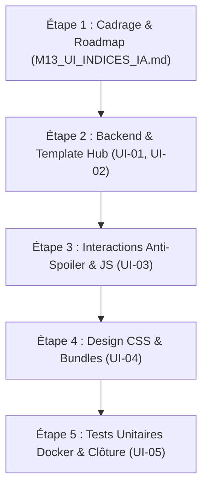

# Plan d'Évolution — Affichage des Indices IA Gemini sur la Page Mot du Jour avec Double Commutateur

**Évolution :** `2026-11-06-ui-indices-ia`  
**Jalon associé :** `docs/milestones/M13_UI_INDICES_IA.md`  
**Branche cible :** `feature/m13-ui-indices-ia` (base `main`)  
**Statut du plan :** Prêt pour exécution  

---

## 1. Contexte & Diagnostic

Le **Jalon M12** a introduit la génération automatisée d'indices IA de haute qualité via Google Gemini, enregistrés dans la table `daily_puzzle_ai_hints`.  
Actuellement, la page hub `/mot-du-jour/` (générée par `src/services/seo_hubs.py`) n'affiche que les 10 mots les plus proches issus de la recherche vectorielle du solveur RAG (`_clue_rows`).

Bien que pertinents, ces mots calculés bruts manquent parfois de nuance pédagogique ou peuvent orienter trop rapidement vers la solution sans expliquer le cheminement de pensée. Les indices générés par Gemini offrent une graduation idéale :
1. Une ambiance/concept abstrait lointain (Niveau 1, poids 0.33)
2. Une fonction/usage pratique (Niveau 2, poids 0.66)
3. Un déclic ou composant emblématique (Niveau 3, poids 1.00)

L'objectif de cette évolution est de donner aux visiteurs le contrôle total de leur expérience d'aide grâce à un double commutateur dynamique, tout en appliquant une stricte politique anti-spoiler.

---

## 2. Spécification Détaillée des Actions (Findings UI-01 à UI-05)

### UI-01 — Extraction Backend & Injection des Indices IA dans le Rendu Hub
- **Cible :** `src/services/seo_hubs.py` (fonction `build_mot_du_jour_page` et `_render_hub_page`).
- **Besoin :** Appeler `get_daily_ai_hints(puzzle_date)` pour récupérer les indices générés en M12.
- **Règles :**
  - Si des indices IA existent pour la date donnée, les injecter dans la structure de données transmise au template.
  - Si aucun indice IA n'existe (ex. puzzle ancien ou défaillance amont), garantir un repli gracieux automatique sur les indices calculés du solveur RAG, sans erreur 500 ni mise en page brisée.

### UI-02 — Gabarit HTML Sémantique & Double Commutateur
- **Cible :** `src/services/seo_templates.py` et `src/services/seo_hubs.py`.
- **Besoin :** Générer les blocs HTML nécessaires avec balisage accessible ARIA :
  1. **Commutateur 1 (Source) :** Boutons à bascule `[ 🤖 Indices IA (Gemini) ]` vs `[ 🌡️ Mots du solveur RAG ]`. Source IA active par défaut.
  2. **Commutateur 2 (Format IA) :** Boutons à bascule `[ 📝 Énigmes (Phrases) ]` vs `[ 🎯 Mots repères ]`. Format Phrases actif par défaut.
  3. **Cartes d'indices IA :** 3 cartes ordonnées du plus éloigné au plus proche :
     - Indice `#1` = Niveau 1 (poids 0.33, froid, univers/concept).
     - Indice `#2` = Niveau 2 (poids 0.66, tiède, fonction/usage).
     - Indice `#3` = Niveau 3 (poids 1.00, chaud/déclic, analogie/composant).
  4. **Tableau RAG préservé :** Conservé dans le panneau alternatif pour les utilisateurs souhaitant consulter la trajectoire vectorielle historique.

### UI-03 — Mécanisme de Masquage Anti-Spoiler & Interactions
- **Cible :** JavaScript inline ou bundle JS (`volumes/web/js/` / script dédié dans `seo_templates.py`).
- **Besoin :**
  - **Par défaut, tout est masqué :** Les phrases, les mots IA et les mots du solveur sont floutés ou masqués par défaut (`.spoiler-hidden`).
  - Action utilisateur : Chaque carte dispose d'un déclencheur de révélation individuel (bouton « 👁️ Révéler l'indice » ou clic sur la zone floutée).
  - Gestion des bascules sans rechargement de page (navigation tabulaire purement côté client).

### UI-04 — Intégration Visuelle CSS & Design System
- **Cible :** `volumes/web/css/` (ou injection CSS critique dans `seo_templates.py`).
- **Besoin :**
  - Stylisation des boutons segmentés (pill-switches / onglets) avec états `active`, `hover`, `focus-visible`.
  - Conception des cartes d'indices avec badges de couleur thermique (`tier-cold`, `tier-warm`, `tier-fire`).
  - Effet spoiler anti-triche : flou gaussien (`filter: blur(8px);`), sélection de texte désactivée (`user-select: none;`) tant que l'élément n'est pas révélé.
  - Compatibilité parfaite mode sombre / mode clair et zéro décalage de mise en page (CLS = 0).

### UI-05 — Validation, Suite de Tests & Contrôles d'Intégrité
- **Cible :** `tests/test_ui_indices_ia.py`, `tools/check_docs.py`, `tools/check_seo.py`, `tools/build_css_bundles.py`.
- **Besoin :**
  - Tests unitaires automatisés validant :
    1. Le rendu des commutateurs et l'activation par défaut (IA + Phrases).
    2. L'ordre strict des indices IA (#1 = le plus éloigné / niveau 1).
    3. La présence des attributs anti-spoiler (aucun texte d'indice lisible par défaut).
    4. Le comportement de repli sans indices IA.
  - Validation complète sous conteneur Docker Python 3.12 (413+ tests sans échec).

---

## 3. Plan d'Exécution par Étapes

---

## 4. Risques & Stratégie de Repli

| Risque identifié | Probabilité | Impact | Stratégie d'atténuation |
|---|:---:|:---:|---|
| **Spoiler accidentel à l'ouverture** | Moyenne | Élevé | Masquage initial strict au niveau du CSS (classe `.spoiler-hidden` chargée dès le CSS critique, indépendamment de l'exécution de JS). |
| **Puzzle sans indices IA en base** | Faible | Moyen | Vérification systématique de la taille de `ai_hints` ; si vide, masque les commutateurs IA et affiche directement le tableau RAG sans rupture. |
| **Régression SEO ou PageSpeed** | Faible | Faible | Contenu HTML sémantique préservé dans le DOM pour l'indexation, interactions légères sans framework tiers lourd, CLS maintenu à 0. |
