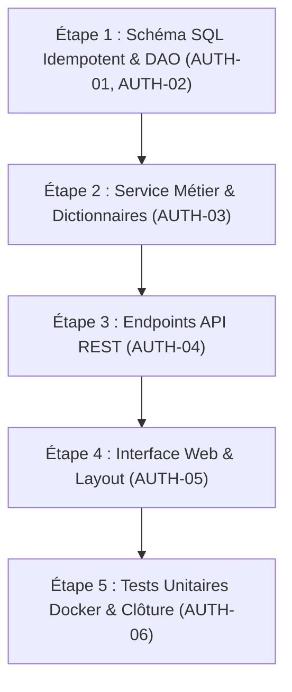

# Plan d'Évolution — Authentification Joueurs sans Email : Profils Invités, Pseudos Personnalisables & Phrase de Secours

**Évolution :** `2026-11-07-authentification-joueurs`  
**Jalon associé :** `docs/milestones/M14_AUTHENTIFICATION_JOUEURS.md`  
**Branche cible :** `feature/m14-authentification-joueurs` (base `main`)  
**Statut du plan :** Prêt pour exécution  

---

## 1. Contexte & Diagnostic

Actuellement, les interactions sur Cémantix Solver (parties en solo, défis contre le bot, salons multijoueurs) s'effectuent sans identité persistante unifiée pour le joueur. Chaque visiteur est anonyme ou dispose d'identifiants éphémères de salon.

Pour développer l'engagement, préparer de futurs classements communautaires et permettre aux utilisateurs de retrouver leurs historiques de jeu sur mobile ou sur un autre ordinateur, un système d'authentification est requis.

Cependant, exiger une adresse email introduirait des frictions importantes (confirmation par email, délivrabilité SMTP, spams, contraintes RGPD lourdes de stockage d'emails).

L'objectif de cette évolution est de déployer un système d'authentification inspiré d'IRC (NickServ) et des jeux modernes :
1. **Création instantanée et silencieuse d'un compte invité** dès la 1ère seconde, avec un pseudo loufoque en français (style Docker : `CastorCosmique`, `PangolinFurtif`).
2. **Possibilité de personnaliser son pseudo une seule fois** avec validation stricte d'unicité.
3. **Protection du compte par mot de passe** pour pouvoir se reconnecter sur n'importe quel appareil.
4. **Attribution d'une phrase de secours de 4 mots français** permettant de récupérer son compte en cas d'oubli de mot de passe, sans jamais avoir besoin d'adresse email.
5. **Schéma extensible** prévoyant nativement l'intégration future optionnelle de Google Sign-In sans rupture de structure.

---

## 2. Spécification Détaillée des Actions (Findings AUTH-01 à AUTH-06)

### AUTH-01 — Schéma Relationnel Idempotent PostgreSQL & SQLite (`players` & `player_dictionary`)
- **Cible :** `database/init.sql`, `src/db/connection.py`.
- **Besoin :**
  - Définition de la table `players` dans `database/init.sql` pour l'initialisation PostgreSQL sous Docker.
  - Définition de la table `player_dictionary` (`id`, `word_type`, `word`, `is_active`, `created_at`) pour stocker dynamiquement les vocabulaires (types: `noun`, `adjective`, `recovery`).
  - Définition miroir dans `PG_SCHEMA` et `SQLITE_SCHEMA` dans `src/db/connection.py`.
  - Intégration d'une fonction de migration/amorçage au démarrage Python : création automatique des tables si absentes et seeding initial du dictionnaire si vide.
- **Règles d'idempotence :**
  - Utilisation systématique de `CREATE TABLE IF NOT EXISTS` et `CREATE INDEX IF NOT EXISTS`.
  - Ré-exécution garantie 20 fois sans erreur ni duplication.

### AUTH-02 — Module de Données & Couche d'Accès DAO
- **Cible :** Nouveau module `src/db/players.py` (exposé dans `src/db/__init__.py`).
- **Besoin :** Fonctions d'accès aux données thread-safe avec gestion transparente PostgreSQL / SQLite :
  - CRUD profils : `create_guest_player`, `get_player_by_token`, `get_player_by_username`, `get_player_by_id`, `update_player_username`, `claim_player_account`, `update_player_password`, `touch_player_activity`.
  - CRUD dictionnaires : `get_active_dictionary(word_type) -> list[str]`, `add_dictionary_word(word_type, word) -> int`, `toggle_dictionary_word(id, is_active) -> bool`.

### AUTH-03 — Service Métier d'Authentification & Dictionnaires
- **Cible :** Nouveau service `src/services/player_auth.py`.
- **Besoin :**
  1. **Générateur de pseudos loufoques (Grammaire stricte `[Nom][Adjectif]`) :**
     - Respect absolu de la syntaxe française : `Nom` (animal/figurant) suivi de l'`Adjectif` (ex: `CastorCosmique`, `PangolinFurtif`). Aucun nom inversé.
     - Longueur totale maîtrisée (entre 8 et 24 caractères, CamelCase sans espace).
     - Alimenté dynamiquement par la base `player_dictionary` avec cache mémoire et repli statique d'urgence.
  2. **Générateur de phrases de secours de 4 mots :**
     - Sélection aléatoire cryptographique via `secrets.choice` parmi les mots `recovery` du dictionnaire.
  3. **Hachage & Sécurité :**
     - Hachage sécurisé du mot de passe via `hashlib.pbkdf2_hmac` avec salt aléatoire (standard Python sans dépendance externe fragile).
     - Normalisation stricte de la phrase de secours (minuscules, tirets) et hachage.
  4. **Validation des pseudos :**
     - Longueur de 3 à 24 caractères, caractères alphanumériques et tirets/underscores uniquement, rejet des mots réservés ou injurieux.

### AUTH-04 — Endpoints API REST HTTP & Routage Caddy
- **Cible :** Serveur HTTP applicatif (`src/services/server.py` ou routeur API dédié).
- **Besoin :**
  - `POST /api/player/guest` : création ou validation d'une session invité.
  - `POST /api/player/rename` : changement unique de pseudo (vérification token + `can_change_username`).
  - `POST /api/player/claim` : sécurisation par mot de passe et émission de la phrase de 4 mots.
  - `POST /api/player/login` : reconnexion multi-appareils par pseudo + mot de passe.
  - `POST /api/player/reset-password` : réinitialisation du mot de passe via phrase de 4 mots.
  - `GET/POST/DELETE /api/snap-9x/dictionary` : endpoints d'administration protégés pour la gestion des mots.
- **Règles & Routage Caddy (`Caddyfile`) :**
  - **Routage automatique :** La directive globale `handle /api/* { reverse_proxy cemantix_web:8000 }` dans `Caddyfile` relaie déjà nativement tous les chemins sous `/api/player/*` et `/api/snap-9x/*` vers le conteneur backend. Aucune modification de route n'est donc requise dans `Caddyfile`.
  - **En-têtes obligatoires :** Émettre systématiquement `Cache-Control: no-store, private` sur toutes les réponses `/api/player/*`.
  - **Codes HTTP propres :** Codes HTTP propres (200, 400 Bad Request, 401 Unauthorized, 409 Conflict si pseudo déjà pris). Réponses JSON standards.

### AUTH-05 — Interface Utilisateur, Intégration Layout & Garantie SEO
- **Cible :** `src/services/layout_sync.py`, `volumes/web/js/auth.js`, `volumes/web/css/auth.css` (intégré dans les bundles via `tools/build_css_bundles.py`).
- **Besoin UX & Contraintes SEO :**
  1. **Garantie d'Innocuité SEO (Zéro Pénalité Google & CLS = 0) :**
     - Pas de modale intrusive au chargement initial. Le contenu principal du jeu reste 100 % accessible.
     - Injection de l'identité joueur 100 % côté client via JS après lecture du `localStorage` (Googlebot voit le contenu pur du mot du jour).
  2. **Toast / Bannière d'Accueil Première Visite :**
     - Bandeau non intrusif affiché uniquement si absence de session joueur :
       *« 👋 Bienvenue ! Ton identité de jeu est CastorCosmique. »* avec actions `[ ✏️ Personnaliser mon pseudo ]`, `[ C'est parti ! ]` et croix `[×]`.
     - Clic sur "C'est parti !" ou la croix : fermeture immédiate et enregistrement de `cemantix_welcome_dismissed = true` dans `localStorage`.
  3. **Badge Permanent dans le Header Commun :**
     - Ajout dans le Header standardisé (synchronisé par `layout_sync.py`) d'une pilule affichant l'icône utilisateur et le pseudo courant : `[ 👤 CastorCosmique ▾ ]`.
  4. **Modale Profil Joueur (`<dialog class="modal">`) :**
     - Accessible au clic sur le bouton "Personnaliser" du bandeau ou au clic sur le badge Header.
     - Gestion des 3 vues : consultation & renommage unique (avec validation longueur 8-24 car.), protection par mot de passe & phrase de secours de 4 mots copiables, et reconnexion multi-appareils.
  5. **Console d'administration (`volumes/web/panier-9x`) :**
     - Ajout d'une section de gestion des listes de mots (`nouns`, `adjectives`, `recovery`) dans l'interface sécurisée avec ajout direct et bascule d'activation.
  6. **Gestion du `localStorage` :**
     - Clé `cemantix_player_session` et `cemantix_welcome_dismissed`. Initialisation en tâche de fond sans blocage de l'interactivité.
  3. **Gestion du `localStorage` :**
     - Stockage propre sous `cemantix_player_session`.
     - Initialisation transparente au premier chargement sans bloquer le rendu de la page (CLS = 0).

### AUTH-06 — FAQ, CGU, Confidentialité, Tests Unitaires & Documentation
- **Cible :** `volumes/web/index.html` (FAQ & JSON-LD `FAQPage`), `tests/test_player_auth.py`, `README.md`, `CHANGELOG.md`.
- **Besoin Juridique & FAQ :**
  1. **Confidentialité (`#confidentialite`) :** Préciser l'usage fonctionnel du `localStorage` pour l'authentification (exempt de consentement préalable CNIL), le stockage haché des mots de passe/clés de secours, et le respect strict du principe de minimisation des données (zéro email collecté).
  2. **Conditions Générales d'Utilisation (`#conditions-utilisation`) :** Règles de bienséance sur les pseudos, rappel de la limite à un renommage unique, avertissement sur la responsabilité du joueur quant à la conservation de sa phrase de secours de 4 mots (aucun reset par email possible).
  3. **Balisage structuré :** Mise à jour du JSON-LD `FAQPage` dans `index.html`.
- **Besoin Tests & Validation :**
  - Couverture complète des cas de test sous Docker Python 3.12 :
    - Génération de pseudo et phrase de secours.
    - Idempotence de la création de table (créer 2 fois d'affilée sans erreur).
    - Scénario complet : visite invité $\rightarrow$ renommage réussi $\rightarrow$ tentative de 2nd renommage rejetée $\rightarrow$ claim avec mot de passe $\rightarrow$ login sur nouvel appareil avec succès $\rightarrow$ échec mauvais mot de passe $\rightarrow$ réinitialisation avec phrase secrète valide $\rightarrow$ échec avec phrase invalide.
  - Documentation utilisateur et technique dans `README.md` et `CHANGELOG.md`.

---

## 3. Plan d'Exécution par Étapes

