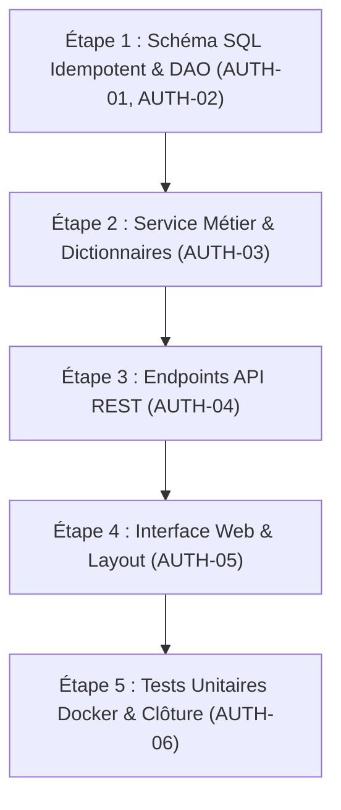

# Plan d'Évolution — Authentification Joueurs sans Email : Profils Invités, Pseudos Personnalisables & Phrase de Secours

**Évolution :** `2026-11-07-authentification-joueurs`  
**Jalon associé :** `docs/milestones/M14_AUTHENTIFICATION_JOUEURS.md`  
**Branche cible :** `feature/m14-authentification-joueurs` (base `main`)  
**Statut du plan :** Prêt pour exécution  

---

## 1. Contexte & Diagnostic

Actuellement, les interactions sur Cémantix Solver (parties en solo, défis contre le bot, salons multijoueurs) s'effectuent sans identité persistante unifiée pour le joueur. Chaque visiteur est anonyme ou dispose d'identifiants éphémères de salon.

Pour développer l'engagement, préparer de futurs classements communautaires et permettre aux utilisateurs de retrouver leurs historiques de jeu sur mobile ou sur un autre ordinateur, un système d'authentification est requis.

Cependant, exiger une adresse email introduirait des frictions importantes (confirmation par email, délivrabilité SMTP, spams, contraintes RGPD lourdes de stockage d'emails).

L'objectif de cette évolution est de déployer un système d'authentification inspiré d'IRC (NickServ) et des jeux modernes :
1. **Création instantanée et silencieuse d'un compte invité** dès la 1ère seconde, avec un pseudo loufoque en français (style Docker : `CastorCosmique`, `PangolinFurtif`).
2. **Possibilité de personnaliser son pseudo une seule fois** avec validation stricte d'unicité.
3. **Protection du compte par mot de passe** pour pouvoir se reconnecter sur n'importe quel appareil.
4. **Attribution d'une phrase de secours de 4 mots français** permettant de récupérer son compte en cas d'oubli de mot de passe, sans jamais avoir besoin d'adresse email.
5. **Schéma extensible** prévoyant nativement l'intégration future optionnelle de Google Sign-In sans rupture de structure.

---

## 2. Spécification Détaillée des Actions (Findings AUTH-01 à AUTH-06)

### AUTH-01 — Schéma Relationnel Idempotent PostgreSQL & SQLite
- **Cible :** `database/init.sql`, `src/db/connection.py`.
- **Besoin :**
  - Définition de la table `players` dans `database/init.sql` pour l'initialisation PostgreSQL sous Docker.
  - Définition miroir dans `PG_SCHEMA` et `SQLITE_SCHEMA` dans `src/db/connection.py`.
  - Intégration d'une fonction de migration ou vérification au démarrage Python pour créer automatiquement la table si elle n'existe pas encore.
- **Règles d'idempotence :**
  - Utilisation de `CREATE TABLE IF NOT EXISTS` et `CREATE INDEX IF NOT EXISTS`.
  - Si le conteneur Docker ou l'application Python est relancé 20 fois, aucune exception ni duplication ne doit survenir.
- **Colonnes obligatoires :**
  - `id` (UUID clé primaire), `auth_token` (token aléatoire 64 car unique), `username` (unique), `can_change_username` (booléen défaut true), `is_claimed` (booléen défaut false), `password_hash` (texte nullable), `recovery_key_hash` (texte nullable), `auth_provider` (défaut 'local'), `google_sub` (unique nullable), `created_at`, `last_seen_at`, `renamed_at`.

### AUTH-02 — Module de Données & Couche d'Accès DAO
- **Cible :** Nouveau module `src/db/players.py` (exposé dans `src/db/__init__.py`).
- **Besoin :** Fonctions d'accès aux données thread-safe avec gestion transparente PostgreSQL / SQLite :
  - `create_guest_player(player_id, auth_token, username) -> dict`
  - `get_player_by_token(auth_token) -> Optional[dict]`
  - `get_player_by_username(username) -> Optional[dict]`
  - `get_player_by_id(player_id) -> Optional[dict]`
  - `update_player_username(player_id, new_username) -> bool`
  - `claim_player_account(player_id, password_hash, recovery_key_hash) -> bool`
  - `update_player_password(player_id, new_password_hash) -> bool`
  - `touch_player_activity(player_id) -> None`

### AUTH-03 — Service Métier d'Authentification & Dictionnaires
- **Cible :** Nouveau service `src/services/player_auth.py`.
- **Besoin :**
  1. **Générateur de pseudos loufoques :**
     - Liste d'au moins 30 adjectifs français évocateurs (*Cosmique, Furtif, Solaire, Flamboyant, etc.*).
     - Liste d'au moins 30 noms d'animaux/personnages (*Pangolin, Castor, Suricate, Caméléon, etc.*).
     - Génération d'un pseudo par défaut, avec suffixe numérique si déjà existant en base.
  2. **Générateur de phrases de secours de 4 mots :**
     - Dictionnaire embarqué d'au moins 256 mots concrets français simples, sans ambiguïté typographique ni accents complexes (*boussole, navire, falaise, volcan, citron, etc.*).
     - Sélection aléatoire cryptographique via `secrets.choice`.
  3. **Hachage & Sécurité :**
     - Hachage sécurisé du mot de passe via `hashlib.pbkdf2_hmac` avec salt aléatoire (standard Python sans dépendance externe fragile).
     - Normalisation stricte de la phrase de secours (minuscules, tirets) et hachage.
  4. **Validation des pseudos :**
     - Longueur de 3 à 24 caractères, caractères alphanumériques et tirets/underscores uniquement, rejet des mots réservés ou injurieux.

### AUTH-04 — Endpoints API REST HTTP & Routage Caddy
- **Cible :** Serveur HTTP applicatif (`src/services/server.py` ou routeur API dédié).
- **Besoin :**
  - `POST /api/player/guest` : création ou validation d'une session invité.
  - `POST /api/player/rename` : changement unique de pseudo (vérification token + `can_change_username`).
  - `POST /api/player/claim` : sécurisation par mot de passe et émission de la phrase de 4 mots.
  - `POST /api/player/login` : reconnexion multi-appareils par pseudo + mot de passe.
  - `POST /api/player/reset-password` : réinitialisation du mot de passe via phrase de 4 mots.
- **Règles & Routage Caddy (`Caddyfile`) :**
  - **Routage automatique :** La directive globale `handle /api/* { reverse_proxy cemantix_web:8000 }` dans `Caddyfile` relaie déjà nativement tous les chemins sous `/api/player/*` vers le conteneur backend. Aucune modification de route n'est donc requise dans `Caddyfile`.
  - **En-têtes obligatoires :** Émettre systématiquement `Cache-Control: no-store, private` sur toutes les réponses `/api/player/*`.
  - **Codes HTTP propres :** Codes HTTP propres (200, 400 Bad Request, 401 Unauthorized, 409 Conflict si pseudo déjà pris). Réponses JSON standards.
  - **Rappel Caddyfile hors Git :** Le fichier `Caddyfile` étant ignoré dans `.gitignore`, si une règle de filtrage ou de rate-limiting Caddy venait à être ajoutée, elle devra être reportée manuellement sur l'hôte et le VPS (`/docker/cemantix-rag-solver/Caddyfile`) avec `caddy reload`.

### AUTH-05 — Interface Utilisateur & Intégration Layout
- **Cible :** `src/services/layout_sync.py`, `volumes/web/js/auth.js`, `volumes/web/css/auth.css` (intégré dans les bundles via `tools/build_css_bundles.py`).
- **Besoin :**
  1. **Badge dans l'en-tête commun :**
     - Ajout dans le Header standardisé (synchronisé par `layout_sync.py`) d'une pilule affichant l'icône utilisateur et le pseudo courant : `[ 👤 CastorCosmique ▾ ]`.
  2. **Modale de gestion de profil :**
     - Affichage des 3 états (invité avec option renommage unique, formulaire de protection avec affichage de la phrase de secours et bouton copier, formulaire de connexion / mot de passe oublié).
  3. **Gestion du `localStorage` :**
     - Stockage propre sous `cemantix_player_session`.
     - Initialisation transparente au premier chargement sans bloquer le rendu de la page (CLS = 0).

### AUTH-06 — Tests Unitaires, Non-Régression & Documentation
- **Cible :** `tests/test_player_auth.py`, `README.md`, `CHANGELOG.md`, `docs/milestones/M14_AUTHENTIFICATION_JOUEURS.md`.
- **Besoin :**
  - Couverture complète des cas de test sous Docker Python 3.12 :
    - Génération de pseudo et phrase de secours.
    - Idempotence de la création de table (créer 2 fois d'affilée sans erreur).
    - Scénario complet : visite invité $\rightarrow$ renommage réussi $\rightarrow$ tentative de 2nd renommage rejetée $\rightarrow$ claim avec mot de passe $\rightarrow$ login sur nouvel appareil avec succès $\rightarrow$ échec mauvais mot de passe $\rightarrow$ réinitialisation avec phrase secrète valide $\rightarrow$ échec avec phrase invalide.
  - Documentation utilisateur et technique dans `README.md` et `CHANGELOG.md`.

---

## 3. Plan d'Exécution par Étapes

