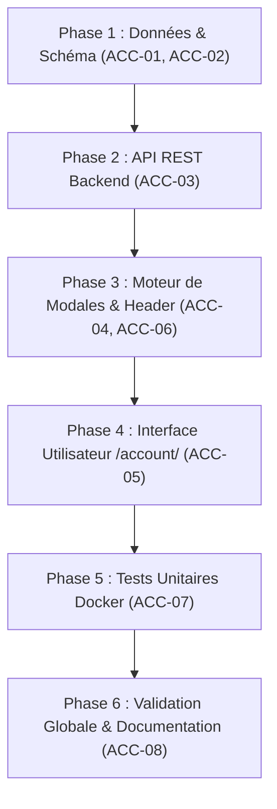

# 👤 Plan — Jalon M16 : Espace « Mon compte », Gestion Avancée du Profil, Sécurité, Mots de Récupération & Statistiques de Jeu

> **Évolution :** [2026-11 · Espace « Mon compte », Sécurité & Statistiques](../README.md) · document 1/2  
> **Jalon technique associé :** [`M16_PAGE_MON_COMPTE.md`](../../milestones/M16_PAGE_MON_COMPTE.md)  
> **Statut du document :** référence de conception, versionnée.  
> **Avancement :** tenu à jour séparément dans [`02-avancement.md`](02-avancement.md) — ce fichier décrit **quoi faire et comment le vérifier**, sans état d'avancement.  
> **Branche de travail :** `feature/m16-espace-mon-compte`  
> **Base de référence :** `main`  
> **Date de conception :** 10/11/2026 (mise à jour : 14/11/2026)  
> **Périmètre exclusif :** `database/init.sql`, `src/db/connection.py`, `src/db/account.py`, `src/api/routes/account.py`, `volumes/web/account/index.html`, `volumes/web/js/account.js`, `volumes/web/css/account.css`, `volumes/web/js/header.js`, `volumes/web/css/modal.css` (maintien absolu du moteur de modales pour l'inscription rapide et le choix d'indices M15), `tests/test_account.py`, `tools/build_css_bundles.py`, `tools/check_docs.py`. Configuration double cible : miroir local Nginx (`local/nginx/cemantix.local.conf`, `local/smoke-test.sh`) et configuration de production Caddy via le fichier racine `Caddyfile` (**iso prod mais HORS GIT**). Aucun impact régressif sur les moteurs de jeu solo, duel ou multi.

**Convention de lecture :** chaque finding porte un identifiant permanent, `ACC-01` à `ACC-08`.  
Les identifiants des jalons précédents (`AUTH-01` à `AUTH-06` pour M14, `SOLO-01` à `SOLO-08` pour M15, `SEO-22` à `SEO-25` pour la découvrabilité) restent inchangés et ne sont pas réutilisés ici.

---

## 1. Contexte Métier & Diagnostic

### 1.1 Diagnostic de l'État Existant (Post-Jalon M14 & M15)

L'implémentation de l'authentification sans email (Jalon M14) a posé les fondations du système d'identité de Cémantix Solver :
1. Attribution automatique d'un profil invité avec pseudo loufoque (`CastorCosmique`).
2. Possibilité de renommer son compte une fois et de le revendiquer via mot de passe et phrase de récupération.
3. Intégration d'une modale universelle (`volumes/web/js/auth.js`) déclenchée depuis le header.

Néanmoins, les retours utilisateurs et l'enrichissement fonctionnel du jeu solo (Jalon M15 — mot du jour autonome, indices roulants IA, classements communautaires) mettent en lumière plusieurs limites structurelles :
- **Absence de centralisation :** Toutes les actions d'authentification et de gestion de compte sont confinées dans une modale compacte (`auth.js`), inadaptée à la consultation de tableaux de bord riches ou à des paramétrages avancés.
- **Manque de visibilité sur les performances :** Le joueur ne dispose d'aucun espace synthétique pour consulter l'historique complet de ses victoires, ses streaks de réussite, son temps moyen de résolution ou la répartition de ses indices utilisés.
- **Gestion rudimentaire de la sécurité :** L'utilisateur ne peut pas modifier son mot de passe de manière autonome ni consulter l'état de fraîcheur de ses accès de sécurité (`password_updated_at`, `last_login_at`).
- **Vulnérabilité en cas de perte de clé :** Le joueur dispose d'une seule phrase de récupération générée à l'inscription initiale, sans mécanisme d'audit d'état ni possibilité de régénération sécurisée en cas de doute.

### 1.2 Objectif Cible : L'Architecture Hybride « Modale Rapide + Page Dédiée »

L'objectif du Jalon M16 est de découpler l'onboarding immédiat de la gestion approfondie du compte :

```text
+-----------------------------------------------------------------------------------+
|                        PARCOURS UTILISATEUR HYBRIDE M16                          |
+-----------------------------------------------------------------------------------+
| 1. Joueur Invité / Non connecté :                                                 |
|    - Clic sur "Mon compte" dans le Header                                         |
|    - Déclenchement de la Modale d'Inscription / Connexion Rapide (auth.js)        |
|    - Maintien du contexte de jeu (zéro rechargement de page, friction minimale)   |
|                                                                                   |
| 2. Joueur Connecté / Protégé :                                                    |
|    - Clic sur son pseudo / badge dans le Header                                   |
|    - Navigation fluide vers la page dédiée `/account/`                            |
|    - Menu vertical à onglets : Profil, Sécurité, Mots de secours, Statistiques    |
|                                                                                   |
| 3. Maintien Transverse du Moteur de Modales :                                     |
|    - Préservation intacte de modal.css / modal engine pour les indices M15        |
|    - Utilisation d'une modale sécurisée pour l'affichage UNIQUE des mots système  |
+-----------------------------------------------------------------------------------+
```

### 1.3 Précision d'Architecture Serveur : Double Cible Local (Nginx) vs Prod (Caddy)

Le déploiement et la livraison web reposent sur une dissociation stricte entre environnements :
- **Environnement Local / Test :** Le serveur web est propulsé par **Nginx** (`local/nginx/cemantix.local.conf`, conteneur non-root port 8080 dans `local/docker-compose.test.yml`). La validation s'effectue via le harnais `local/smoke-test.sh`.
- **Environnement de Production :** L'infrastructure officielle tourne sous **Docker + Caddy**. Le fichier de référence appliqué sur le serveur est situé à la racine du dépôt local : `Caddyfile` (`c:\dev\docker\cemantix_solver\Caddyfile`). Ce fichier est **strictement iso production**, mais il est **HORS GIT** (ignoré via `.gitignore:85`) pour des raisons de sécurité et d'isolation des variables d'environnement hôte. Toute nouvelle route web (telle que `/account/`) doit donc y être intégrée manuellement lors du déploiement.

---

## 2. Matrice des Findings & Chantiers (ACC-01 à ACC-08)

| # | Sév. | Composant | Problème constaté / Besoin | Correctif spécifié | Critère de vérification |
|---|---|---|---|---|---|
| **ACC-01** | 🔴 | Schéma BDD (`database/init.sql`, `src/db/connection.py`) | Absence de table pour stocker les mots de récupération système et manque de colonnes de suivi temporel de sécurité sur `players`. | Création idempotente de la table `player_recovery_words` (`player_id`, `word_hash`, `created_at`) avec contrainte `UNIQUE` et index. Ajout conditionnel des colonnes `password_updated_at` et `last_login_at` sur `players`. DDL miroir PostgreSQL et SQLite. | Tests unitaires sous Docker exécutant 20 cycles d'initialisation sans erreur ; intégrité référentielle `ON DELETE CASCADE` validée. |
| **ACC-02** | 🔴 | DAO & Métier Sécurité (`src/db/account.py`, `src/db/__init__.py`) | Pas de module dédié à la gestion avancée du compte, au hachage des mots de récupération et à la purge atomique lors du renouvellement. | Création de `src/db/account.py` : fonctions de vérification et mise à jour de mot de passe, génération aléatoire cryptographique de 4 mots de récupération système, hachage PBKDF2-HMAC-SHA256, régénération atomique avec purge des anciens mots, et agrégation des métriques de jeu. | `docker compose run --rm -v ./tests:/app/tests --entrypoint python cemantix -m unittest tests/test_account.py` vert. |
| **ACC-03** | 🔴 | Endpoints API REST (`src/api/routes/account.py`, `src/api/server.py`) | Absence d'API REST unifiée pour piloter l'espace `/account/` (profil, mot de passe, récupération, stats, déconnexion). | Implémentation du routeur `/api/account/*` avec endpoints `profile`, `password`, `recovery` (GET état / POST régénération), `stats` et `logout`. Extraction du jeton Bearer, validation stricte des entrées et en-têtes `Cache-Control: no-store, private`. | Tests HTTP sous Docker vérifiant les codes 200, 400, 401, 403 et 404, ainsi que le rejet des mots de passe faibles. |
| **ACC-04** | 🟠 | Moteur Global de Modales (`volumes/web/css/modal.css`, `volumes/web/js/auth.js`) | Risque de régression du moteur de modales lors de l'introduction de la page dédiée, affectant l'inscription rapide et la sélection d'indices M15. | Maintien et sanctuarisation de `<dialog class="modal">` et de ses styles. Conservation de la modale d'enregistrement rapide pour les profils invités et garantie d'isolation vis-à-vis des composants du Jalon M15. | `python tools/build_css_bundles.py --check` vert ; tests d'ouverture/fermeture et gestion Escape / focus trap validés. |
| **ACC-05** | 🔴 | Vue Dédiée `/account/` (`volumes/web/account/index.html`, `account.js`, `account.css`) | Manque d'une interface complète et ergonomique pour gérer son profil, sa sécurité et consulter ses statistiques de jeu. | Création de la page `/account/index.html` avec navigation par menu vertical (Profil, Sécurité, Mots de récupération, Statistiques). Logique JS gérant le rendu dynamique, l'affichage unique des mots générés avec confirmation de copie, et les graphiques/métriques. | Rendu responsive sans débordement (mobile/bureau), audit CSS conforme et tests de navigation entre onglets passants. |
| **ACC-06** | 🟠 | Routage Header Universel & Proxies Web (`layout_sync.py`, `header.js`, `Caddyfile`, `local/nginx/`) | Le clic sur le badge header doit router intelligemment selon le statut, et les reverse-proxies Nginx/Caddy doivent servir `/account/` sans soft 404. | Routage biface JS dans le header ; synchronisation `layout_sync.py` ; mise à jour de `local/nginx/cemantix.local.conf` (test) et du fichier racine `Caddyfile` iso prod hors Git (ajout de `/account` et `/account/*` dans `@pages`). | `bash local/smoke-test.sh` vert (GET `/account/` -> 200) ; rechargement Caddy `caddy reload` validé. |
| **ACC-07** | 🟡 | Suite de Tests Automatisés (`tests/test_account.py`) | Absence de couverture de tests sur la gestion de compte, la sécurité des mots de récupération et les statistiques personnelles. | Rédaction d'une suite exhaustive sous `tests/test_account.py` couvrant le cycle de vie complet du compte, la robustesse cryptographique, les endpoints REST, la régénération des mots de secours et l'agrégation de stats. | `docker compose run --rm -v ./tests:/app/tests --entrypoint python cemantix -m unittest discover -s tests` à 100% vert. |
| **ACC-08** | 🟡 | Validation Globale & Documentation (`tools/check_docs.py`, `tools/build_css_bundles.py`, `README.md`) | Risque de dérive documentaire, de liens morts dans la roadmap ou de bundles CSS désynchronisés. | Enregistrement du bundle `account.css` dans `tools/build_css_bundles.py`, mise à jour de l'index des évolutions dans `docs/roadmap/README.md`, consignation dans `CHANGELOG.md` et validation outillée. | `python tools/check_docs.py` vert (0 erreur de lien, de table ou de compteur) et compilation CSS sans erreur. |

---

## 3. Spécifications Techniques

### 3.1 Schéma Relationnel Idempotent & Double Dialecte (`ACC-01`)

Le schéma doit pouvoir être exécuté sans altération sur PostgreSQL en production et SQLite en tests unitaires locaux.

#### DDL PostgreSQL (`database/init.sql`)
```sql
-- Table des mots de récupération aléatoires attribués par le système
CREATE TABLE IF NOT EXISTS player_recovery_words (
    id          SERIAL PRIMARY KEY,
    player_id   UUID NOT NULL REFERENCES players(id) ON DELETE CASCADE,
    word_hash   VARCHAR(255) NOT NULL,
    created_at  TIMESTAMPTZ NOT NULL DEFAULT CURRENT_TIMESTAMP,
    UNIQUE(player_id, word_hash)
);
CREATE INDEX IF NOT EXISTS idx_player_recovery_words_player ON player_recovery_words(player_id);

-- Colonnes de sécurité additionnelles sur la table players
DO $$ 
BEGIN
    IF NOT EXISTS (SELECT 1 FROM information_schema.columns WHERE table_name='players' AND column_name='password_updated_at') THEN
        ALTER TABLE players ADD COLUMN password_updated_at TIMESTAMPTZ DEFAULT NULL;
    END IF;
    IF NOT EXISTS (SELECT 1 FROM information_schema.columns WHERE table_name='players' AND column_name='last_login_at') THEN
        ALTER TABLE players ADD COLUMN last_login_at TIMESTAMPTZ DEFAULT NULL;
    END IF;
END $$;
```

#### DDL SQLite Miroir (`src/db/connection.py`)
```sql
CREATE TABLE IF NOT EXISTS player_recovery_words (
    id          INTEGER PRIMARY KEY AUTOINCREMENT,
    player_id   TEXT NOT NULL REFERENCES players(id) ON DELETE CASCADE,
    word_hash   TEXT NOT NULL,
    created_at  TEXT NOT NULL DEFAULT CURRENT_TIMESTAMP,
    UNIQUE(player_id, word_hash)
);
CREATE INDEX IF NOT EXISTS idx_player_recovery_words_player ON player_recovery_words(player_id);
```

#### Étude d'Impact & Dimensionnement BDD
- **Empreinte unitaire :** Chaque ligne de mot de récupération pèse ~80 octets de données + ~48 octets d'index = **~128 octets**.
- Pour 10 000 comptes actifs disposant de 4 mots de récupération générés par le système : 40 000 lignes, soit **~5,1 Mo** de volumétrie totale. L'impact matériel sur PostgreSQL est négligeable.

---

### 3.2 Implémentation de la Sécurité & Mots de Récupération Système (`ACC-02`)

1. **Génération Aléatoire par le Système :**
   - Les mots de récupération ne sont **jamais choisis par l'utilisateur**.
   - Le système sélectionne cryptographiquement 4 mots uniques via `secrets.choice` parmi les termes actifs du dictionnaire de récupération (`player_dictionary` avec `word_type='recovery'`).
2. **Hachage Cryptographique en Base :**
   - Chaque mot est haché individuellement via `hashlib.pbkdf2_hmac` avec un sel cryptographique ou un format SHA-256 salé avant insertion dans `player_recovery_words`.
   - Aucun mot en clair n'est stocké en base de données.
3. **Affichage Unique & Avertissement UX :**
   - Les 4 mots en clair ne sont renvoyés **qu'une seule fois**, dans la réponse JSON de la requête de création initiale ou de régénération explicite.
   - L'interface affiche une boîte d'alerte avec bouton de copie et confirmation : *« Conservez ces 4 mots dans un endroit sécurisé. Ils ne seront plus jamais réaffichés. »*
4. **Régénération Atomique :**
   - Lorsqu'un utilisateur demande la régénération de ses mots de secours, une transaction SQL supprime l'intégralité des entrées existantes dans `player_recovery_words` pour ce `player_id` avant d'insérer les nouveaux hachages.

---

### 3.3 Endpoints API REST Backend (`ACC-03`)

Les routes sont hébergées sous le préfixe `/api/account/*` dans `src/api/routes/account.py` et intégrées dans `src/api/server.py` :

| Méthode | Route | Description | Entrée (JSON / Headers) | Réponse Succès | Erreurs Possibles |
|---|---|---|---|---|---|
| `GET` | `/api/account/profile` | Récupère le profil du joueur connecté | `Authorization: Bearer <token>` | `200 OK` : `{ username, isClaimed, createdAt, passwordUpdatedAt, lastLoginAt }` | `401 Unauthorized` |
| `POST` | `/api/account/password` | Modifie le mot de passe du compte | `{ currentPassword, newPassword }` + Bearer | `200 OK` : `{ success: true, message: "Mot de passe mis à jour" }` | `400 Bad Request`, `401 Unauthorized` |
| `GET` | `/api/account/recovery` | Consulte le statut des mots de secours | `Authorization: Bearer <token>` | `200 OK` : `{ configured: true, count: 4, generatedAt: "..." }` | `401 Unauthorized` |
| `POST` | `/api/account/recovery` | Régénère les mots de récupération | `Authorization: Bearer <token>` | `200 OK` : `{ success: true, recoveryWords: ["mot1", "mot2", "mot3", "mot4"] }` | `401 Unauthorized`, `403 Forbidden` |
| `GET` | `/api/account/stats` | Récupère les statistiques de jeu | `Authorization: Bearer <token>` | `200 OK` : `{ totalGames, victories, winRate, avgGuesses, bestScore, avgTimeSeconds, hintsUsed }` | `401 Unauthorized` |
| `POST` | `/api/account/logout` | Invalide la session active | `Authorization: Bearer <token>` | `200 OK` : `{ success: true, message: "Déconnexion réussie" }` | `200 OK` (idempotent) |

Toutes les réponses émettent contractuellement l'en-tête HTTP :  
`Cache-Control: no-store, private, max-age=0`

---

### 3.4 Workflows UI & Ergonomie de l'Espace `/account/` (`ACC-04` à `ACC-06`)

#### 3.4.1 Structure de la Page `/account/` avec Menu Vertical
La page `/account/index.html` est articulée autour d'un conteneur responsive à deux panneaux :
- **Panneau latéral gauche (Menu vertical) :**
  - Onglet 1 : `👤 Mon Profil` (Identité, pseudo, date d'inscription).
  - Onglet 2 : `🔒 Sécurité & Accès` (Changement de mot de passe, traçabilité des connexions).
  - Onglet 3 : `🔑 Mots de Récupération` (Statut des mots, régénération avec affichage unique).
  - Onglet 4 : `📊 Statistiques de Jeu` (Parties jouées, victoires, temps moyen, indices).
  - Bouton d'action direct : `🚪 Se déconnecter` (purge du `localStorage` et redirection).
- **Panneau central droit (Contenu actif) :**
  - Affiche dynamiquement la section sélectionnée sans rechargement de page.

#### 3.4.2 Maintien de la Modale d'Onboarding Rapide
- Pour les utilisateurs non authentifiés ou les profils invités naviguant sur `/play/` ou `/`, le header propose le bouton « Mon compte ».
- Au clic, le système ouvre immédiatement la modale d'enregistrement rapide (`volumes/web/js/auth.js`) pour ne pas couper le flux de résolution de la grille de jeu.
- Le moteur de modales `modal.css` reste pleinement opérationnel et continue de propulser la modale d'indices IA introduite au Jalon M15.

---

### 3.5 Infrastructure de Livraison & Double Cible Proxy (`ACC-06`, `ACC-08`)

La configuration réseau doit être alignée sur les deux environnements sans divergence de comportement :

```text
+------------------------------------------------------------------------------------+
|                      DOUBLE INFRASTRUCTURE SERVEUR DU PROJET                       |
+------------------------------------------------------------------------------------+
| LOCAL / TEST :                                                                     |
|   - Serveur : Nginx (local/nginx/cemantix.local.conf)                              |
|   - Routage : try_files $uri $uri/index.html $uri/ =404;                           |
|   - Proxy API : location /api/ -> reverse_proxy cemantix_web:8000                 |
|   - Contrôle : local/smoke-test.sh avec vérification GET /account/ -> 200          |
|                                                                                    |
| PRODUCTION :                                                                       |
|   - Serveur : Docker + Caddy (fichier Caddyfile à la racine, HORS GIT)             |
|   - Gestion du cache : directive @pages enrichie avec /account et /account/*       |
|     header @pages Cache-Control "no-cache, must-revalidate"                        |
|   - Proxy API : handle /api/* { reverse_proxy cemantix_web:8000 }                  |
|   - Rechargement : docker exec <caddy> caddy reload --config /etc/caddy/Caddyfile  |
+------------------------------------------------------------------------------------+
```

1. **Miroir Local Nginx (`local/nginx/cemantix.local.conf`) :**
   - La directive `try_files $uri $uri/index.html $uri/ =404;` sert nativement `/account/index.html`.
   - Le bloc `set $cemantix_api http://cemantix_web:8000; location /api/` achemine les requêtes `/api/account/*` vers le conteneur Python.
   - Le script `local/smoke-test.sh` est enrichi pour vérifier systématiquement le code `200` sur `/account/`.
2. **Configuration Caddy de Production (`Caddyfile` racine, hors Git) :**
   - Le fichier `Caddyfile` de déploiement racine (ignoré par Git) doit être mis à jour pour intégrer `/account` et `/account/*` dans le sélecteur `@pages` :
     ```caddy
     @pages path / /puzzles /puzzles/* /play /play/* /battle /battle/* /multi /multi/* /defi /defi/* /account /account/*
     header @pages Cache-Control "no-cache, must-revalidate"
     ```
   - Le bloc `handle /api/* { reverse_proxy cemantix_web:8000 }` achemine déjà automatiquement toutes les requêtes d'API du compte sans modification de règle requise.
   - Les modifications sont appliquées sans coupure de service par :
     ```bash
     docker exec <caddy> caddy reload --config /etc/caddy/Caddyfile
     ```

---

## 4. Plan d'Exécution par Phases



1. **Phase 1 — Persistance & Sécurité des Données (`ACC-01`, `ACC-02`) :**
   - Mise à jour de `database/init.sql` et `src/db/connection.py`.
   - Implémentation du module `src/db/account.py` (CRUD compte, génération aléatoire, purge et hachage).
2. **Phase 2 — Contrôleur REST & Routage HTTP (`ACC-03`) :**
   - Création de `src/api/routes/account.py` et intégration dans `src/api/server.py`.
   - Validation des codes HTTP et des en-têtes anti-mise en cache.
3. **Phase 3 — Sanctuarisation Modale & Routage Proxies (`ACC-04`, `ACC-06`) :**
   - Vérification de l'intégrité de `volumes/web/css/modal.css` et `auth.js`.
   - Adaptation du header dans `src/services/layout_sync.py` et `volumes/web/js/header.js` pour router selon le statut de connexion.
   - Alignement du miroir Nginx local et du fichier racine `Caddyfile` iso prod hors Git.
4. **Phase 4 — Frontend `/account/` & Styles (`ACC-05`) :**
   - Création de `volumes/web/account/index.html`, `volumes/web/js/account.js` et `volumes/web/css/account.css`.
   - Implémentation du menu vertical et de la modale d'affichage unique des mots de secours.
5. **Phase 5 — Validation par Tests Automatisés sous Docker (`ACC-07`) :**
   - Création de la suite de tests `tests/test_account.py`.
   - Exécution sous Docker des tests unitaires et de non-régression.
6. **Phase 6 — Bundles CSS, Documentation & Audit (`ACC-08`) :**
   - Déclaration du bundle CSS `account` dans `tools/build_css_bundles.py`.
   - Exécution de `python tools/check_docs.py` et mise à jour de `CHANGELOG.md` et `README.md`.

---

## 5. Recette & Critères de Validation

### 5.1 Suite de Vérification Technique sous Docker & Local Nginx
Toutes les commandes applicatives s'exécutent exclusivement sous Docker :

```bash
# 1. Validation de la suite de tests unitaires dédiée au compte
docker compose run --rm -v ./tests:/app/tests --entrypoint python cemantix -m unittest tests/test_account.py -v

# 2. Exécution de la suite complète de non-régression (Solo, Battle, Multi, Auth, Account)
docker compose run --rm -v ./tests:/app/tests --entrypoint python cemantix -m unittest discover -s tests

# 3. Contrôle de la fraîcheur et de la validité des bundles CSS
python tools/build_css_bundles.py --check

# 4. Contrôle de cohérence de l'ensemble de la documentation
python tools/check_docs.py

# 5. Validation HTTP sur le miroir Nginx local
bash local/smoke-test.sh
```

### 5.2 Recette de Production Caddy
Après déploiement du conteneur applicatif et application de la configuration racine `Caddyfile` (hors Git) :

```bash
# Rechargement à chaud de la configuration Caddy
docker exec <caddy> caddy reload --config /etc/caddy/Caddyfile

# Vérification des statuts HTTP et des en-têtes
curl -sI https://cemantix.cyril-randon.fr/account/
# Attendu : HTTP/2 200, Content-Type: text/html, Cache-Control: no-cache, must-revalidate

curl -sI https://cemantix.cyril-randon.fr/api/account/profile
# Attendu : HTTP/2 401 Unauthorized, Cache-Control: no-store, private

curl -sI https://cemantix.cyril-randon.fr/inexistant
# Attendu : HTTP/2 404 Not Found (vrai 404, zéro soft 404 vers /index.html)
```

### 5.3 Scénarios de Recette Fonctionnelle
1. **Onboarding invité :** Arrivée sur `/play/`, clic sur « Mon compte » dans le header → ouverture immédiate de la modale d'inscription rapide sans rechargement de page.
2. **Consultation du compte :** Utilisateur connecté, clic sur le badge header → navigation vers `/account/` avec onglet « Mon Profil » affiché par défaut.
3. **Changement de mot de passe :** Saisie d'un mot de passe incorrect → message d'erreur clair. Saisie du bon mot de passe et d'un nouveau mot de passe robuste → confirmation visuelle et mise à jour de `password_updated_at`.
4. **Régénération des mots de récupération :** Clic sur « Régénérer mes mots », confirmation de l'action → affichage d'un panneau modal avec les 4 mots en clair et bouton « Copier ». Rechargement de la page → les mots ne sont plus visibles, seul le statut « 4 mots configurés » apparaît.
5. **Statistiques :** Consultation de l'onglet « Statistiques » → affichage fidèle du nombre de parties terminées, victoires et pourcentages.
6. **Déconnexion :** Clic sur « Se déconnecter » → suppression des identifiants dans le `localStorage`, réinitialisation du header et redirection propre.

---

## 6. Risques, Mitigations & Rollbacks

| Risque Identifié | Impact | Probabilité | Stratégie de Mitigation |
|---|---|---|---|
| Régression sur le moteur de modales affectant les indices M15 | Élevé | Faible | Les composants de `modal.css` et la classe standard `<dialog class="modal">` sont sanctuarisés sans modification destructrice. Tests croisés sur `/play/`. |
| Fuite ou interception des mots de récupération système | Critique | Très faible | Mots générés cryptographiquement, hachés avant persistance BDD, émis en clair une seule et unique fois dans la réponse POST sécurisée. |
| Divergence de configuration entre Nginx local et Caddy prod | Moyen | Faible | Le fichier `Caddyfile` racine est maintenu strictement iso production ; le miroir Nginx `cemantix.local.conf` réplique exactement les mêmes règles et les smoke tests locaux valident les deux cibles. |
| Désynchronisation du Header entre les pages statiques | Moyen | Faible | Synchronisation centralisée assurée par `src/services/layout_sync.py` au démarrage du conteneur. |
| Incohérence des statistiques personnelles | Faible | Moyenne | Requêtes d'agrégation SQL basées sur des clés étrangères strictes (`player_id`) avec filtres explicites sur les parties achevées (`status = 'finished'`). |
| **Procédure de Rollback** | Moyen | — | En cas d'anomalie bloquante : `git revert` des commits de la branche `feature/m16-espace-mon-compte`. Les ajouts DDL en BDD étant purement additifs (`IF NOT EXISTS`), aucun script de suppression destructive n'est nécessaire. Rechargement immédiat de Caddy si besoin. |
